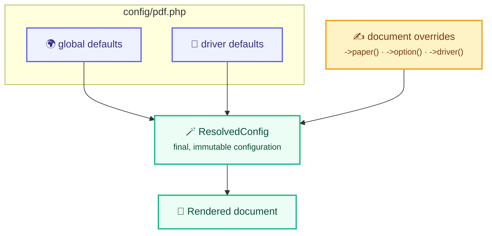

# 📄 Laravel Vellum

> **One API. Any source. Any engine. Every compliance feature.**
>
> Turn *anything* — a Blade view, raw HTML, a file, Twig, a remote URL — into a PDF with *any
> engine* — DOMPDF, Chromium (Browsershot), mPDF — without rewriting your code.
>
> **Vellum** — *the sheet the document is composed on*. You pick the source and the engine; Vellum
> does the rest.

<p align="center">
  
  
  
  
  
  
</p>

<p align="center">
  
  
  
  
  
  
</p>

[Español](README.md) · **English**

> [!NOTE]
> **Status:** the package is not published on Packagist yet. Install it from a local
> (`type: path`) repository; see [Installation](#3-installation).

---

## ⚡ In 30 seconds

| # | Step | Action |
| :-: | --- | --- |
| 1️⃣ | **Install** | Add the local repository and run `composer update` |
| 2️⃣ | **Pick an engine** | `composer require dompdf/dompdf` (or mPDF / Browsershot) |
| 3️⃣ | **Render** | `Pdf::view('invoice', $data)->download('invoice.pdf')` |

Add the package to your `composer.json`:

```json
{
    "repositories": [
        { "type": "path", "url": "../laravel-vellum", "options": { "symlink": true } }
    ],
    "require": {
        "laravel-vellum/laravel-vellum": "*@dev"
    }
}
```

```bash
composer update laravel-vellum/laravel-vellum
composer require dompdf/dompdf   # or mpdf/mpdf, or spatie/browsershot
php artisan vendor:publish --tag=pdf-config
```

```php
use Vellum\Facades\Pdf;

return Pdf::view('invoices.invoice', ['invoice' => $invoice])
    ->driver('dompdf')
    ->paper('a4')
    ->download('invoice.pdf');
```

> [!TIP]
> Change only `->driver('dompdf')` to `->driver('mpdf')` or `->driver('browsershot')`: the rest of
> the document stays the same.

Details are in [Installation](#3-installation) and [Quick start](#4-quick-start).

---

## Table of contents

| # | Section | What you will find |
| --- | --- | --- |
| 1 | 🧭 [Why another PDF package](#1-why-another-pdf-package) | Honest comparison with the packages you already know |
| 2 | 🧩 [At a glance](#2-at-a-glance) | The capability matrix and the architecture in one picture |
| 3 | 📦 [Installation](#3-installation) | Local repository, engines, config, Node/Chromium, Lumen |
| 4 | 🚀 [Quick start](#4-quick-start) | The five terminal methods and the fluent API |
| 5 | 🗂️ [Where the package lives in your app](#5-where-the-package-lives-in-your-app) | File-by-file map of every file you touch |
| 6 | 📥 [Sources](#6-sources) | 5 sources + your own, with real examples |
| 7 | ⚙️ [Drivers](#7-drivers) | 4 drivers + your own, with the upstream library explained |
| 8 | 🧰 [Configuration reference](#8-configuration-reference) | `config/pdf.php` explained key by key |
| 9 | 🪄 [Layering and precedence](#9-layering-and-precedence) | Exactly who wins, and why |
| 10 | 🧪 [Post-processing pipeline](#10-post-processing-pipeline) | Metadata, XMP, PDF/A-3b, embeds, merge, signature |
| 11 | 🍳 [Recipes](#11-recipes) | 14 ready-to-copy recipes for common tasks |
| 12 | 🧱 [Extending the package](#12-extending-the-package) | Custom source, driver, processor |
| 13 | 🚨 [Errors, warnings, timeouts](#13-errors-warnings-timeouts) | The full exception map and the resilience rules |
| 14 | ✅ [Testing your application](#14-testing-your-application) | The Fake driver and the call recorder |
| 15 | 🗺️ [Project structure](#15-project-structure) | Every file of `src/` explained |
| 16 | 🛠️ [Development and CI](#16-development-and-ci) | Commands and the matrix |
| 17 | 🌍 [Ecosystem map](#17-ecosystem-map) | Who does what, and when to use what |

---

## 1. Why another PDF package

There are excellent packages out there. Most of them bind you to **one engine**:

| Package | Engine | Why you might still need this one |
| --- | --- | --- |
| [`barryvdh/laravel-dompdf`](https://github.com/barryvdh/laravel-dompdf) (~7.3k ⭐, MIT) | DOMPDF only | You cannot switch to Chromium/mPDF without rewriting your calls. |
| [`spatie/laravel-pdf`](https://github.com/spatie/laravel-pdf) (~1.05k ⭐, MIT) | Browsershot only | Chromium everywhere is expensive for simple invoices. |
| [`barryvdh/laravel-snappy`](https://github.com/barryvdh/laravel-snappy) (~2.75k ⭐, MIT) | wkhtmltopdf only | Needs a system binary; old Qt WebKit. |
| `mpdf/mpdf` (~4.7k ⭐, **GPL-2.0**) | mPDF only | Not a Laravel package, and the license is copyleft. |

**This package is the layer above all of them.** It keeps the *shape* of the packages you already
use (a facade, a fluent builder, `->download()`) and adds the three things they lack:

| | Superpower | What it gives you |
| :-: | --- | --- |
| 📥 | **A source contract** | Blade, HTML, file, Twig, URL — and yours — behind one interface. |
| ⚙️ | **A driver contract** | Engines are *optional* dependencies. Missing ⇒ an exception with the exact `composer require`. |
| 🧪 | **A post-processing pipeline** | PDF/A-3b, XMP, ZUGFeRD/Factur-X embeds, merge and signatures work **on the bytes**, with every engine — including the fake one. |

```mermaid
flowchart LR
    A["📥 Source<br/><small>Blade · HTML · File · Twig · URL</small>"] --> B["🧱 PdfBuilder<br/><small>fluent, immutable API</small>"]
    B --> C["🪄 ConfigResolver<br/><small>3 typed layers</small>"]
    C --> D["⚙️ Driver<br/><small>dompdf · browsershot · mpdf · fake</small>"]
    D --> E["🧪 Pipeline<br/><small>XMP · PDF/A · embeds · merge · signature</small>"]
    E --> F["📦 PdfResult<br/><small>bytes · save · stream · download</small>"]

    classDef source fill:#eef2ff,stroke:#6366f1,stroke-width:2px,color:#312e81;
    classDef builder fill:#f5f3ff,stroke:#8b5cf6,stroke-width:2px,color:#4c1d95;
    classDef driver fill:#ecfeff,stroke:#06b6d4,stroke-width:2px,color:#164e63;
    classDef pipeline fill:#fff7ed,stroke:#f59e0b,stroke-width:2px,color:#78350f;
    classDef result fill:#ecfdf5,stroke:#10b981,stroke-width:2px,color:#064e3b;

    class A source;
    class B,C builder;
    class D driver;
    class E pipeline;
    class F result;
```



<details>
<summary>🧱 The same diagram as text (terminal or viewers without Mermaid)</summary>

```
        ┌───────────────────── Vellum\Facades\Pdf ─────────────────────┐
        │                                                              │
        ▼                                                               ▼
   PdfManager ──▶ PdfBuilder (immutable, fluent) ──▶ render() ──▶ PdfResult
        │                 │                          │                │
        │                 │                          ▼                ▼
        │                 │                   DriverRegistry       bytes()/save()
        │                 │                          │            stream()/download()
        │                 ▼                          ▼
        │            ConfigResolver ──▶ ResolvedConfig ──▶ Pipeline ──▶ PdfContext
        │            (3 config layers)      (typed)         (post-processors)
        ▼
   Sources: Blade · HTML · File · Twig · URL · custom
```

</details>

---

## 2. At a glance

### 2.1 📥 The five sources × four drivers matrix

Every source works with every driver. **20 combinations out of the box** (5 sources × 4 drivers),
plus whatever you add with your own contracts.

| | `dompdf` | `browsershot` | `mpdf` | `fake` |
| --- | :---: | :---: | :---: | :---: |
| 📄 `blade` (Blade view) | ✅ | ✅ | ✅ | ✅ |
| 🧾 `html` (raw HTML string) | ✅ | ✅ | ✅ | ✅ |
| 📁 `file` (local file) | ✅ | ✅ | ✅ | ✅ |
| 🌿 `twig` (Twig template) | ✅ | ✅ | ✅ | ✅ |
| 🌐 `url` (remote URL) | ✅ | ✅ | ✅ | ✅ |
| 🧩 `custom` (your `Source`) | ✅ | ✅ | ✅ | ✅ |

### 2.2 🧰 What the package can do, and where the feature lives

| | Capability | API | Implemented in | Notes |
| :-: | --- | --- | --- | --- |
| 🎯 | Pick an engine per document | `->driver('mpdf')` | `PdfBuilder::driver()` | Overrides the config default. |
| 📐 | Paper size / orientation | `->paper('a4', 'landscape')` | `Config\PaperSize`, `Config\Orientation` | 8 sizes × 2 orientations, validated. Paper always comes from here, not from CSS. |
| 🔤 | Fonts (family + local file) | `->font('Inter', '/path.ttf')` | `Support\PageHtml` | Injects `@font-face` into the HTML. |
| 📏 | Margins (mm) | `->margins(10, 10, 10, 10)` | `Config\Margins` | `@page` for DOMPDF, `SetMargins()` for mPDF, Puppeteer options for Chromium. |
| 🧰 | Engine specific options | `->option('isPhpEnabled', false)` | `Config\DocumentOptions` | Forwarded verbatim to the engine. |
| 🏷️ | Document metadata | `->metadata([...])` | `Pipeline\Processors\SetDocumentMetadata` | Title, author, subject, keywords, creator, custom. |
| 🧾 | XMP packet | `->xmp([...])`, `->xmpNamespace()` | `Pipeline\Processors\EmbedXmpMetadata` | Dublin Core + custom namespaces. |
| 🗄️ | PDF/A-3b | `->pdfa('/path/sRGB2014.icc')` | `Pipeline\Processors\MarkPdfA3b` | Output intent + `pdfaid` metadata. |
| 📎 | Embedded files | `->embedFile($path, $name, 'Data', 'text/xml')` | `Pipeline\Processors\EmbedFile` | `/Filespec` + `/EmbeddedFile`. |
| 🇪🇺 | ZUGFeRD / Factur-X | `->zugferd('/tmp/invoice.xml')` | `zugferd()` + the two processors above | Convenience wrapper over XMP + PDF/A + embed. |
| 🔗 | Merge PDFs | `->merge('/tmp/cover.pdf')` | `Pipeline\Processors\MergePdfs` | Uses [`setasign/fpdi`](https://github.com/setasign/FPDI). |
| ✍️ | Digital signature | `->sign('/cert.p12', 'secret')` | `Pipeline\Processors\AddSignature` | PKCS#7 detached, CMS/PKCS#7 DER. |
| 🧩 | Custom post-processing | `->process(new MyProcessor())` | `Pipeline\Pipeline` | Also registerable globally in the config. |
| ⏱️ | Timeout protection | `->timeout(15)` | `Support\RenderGuard` | Hard limit, never an infinite render. |
| ⚠️ | Warning collection | `->strictWarnings()` | `Support\WarningCollector` | Engine warnings are logged, never swallowed. |
| 📤 | Stream / download / save | `->stream()`, `->download()`, `->save()` | `Support\PdfResult` | Standard Laravel responses. |
| 🧪 | Deterministic test doubles | `->driver('fake')` | `Drivers\FakeDriver` | Valid PDF bytes, zero engines. |

### 2.3 🧭 Pick your engine in 10 seconds

| If you need… | Use | Why |
| --- | :-: | --- |
| 🧾 Simple invoices and reports, no Node | `dompdf` | Pure PHP, zero infrastructure. |
| 🌐 Tailwind, CSS Grid, web fonts or pixel-perfect output | `browsershot` | Chromium renders exactly what the browser shows. |
| 🌍 Arabic, Hebrew, CJK, RTL or lots of PDFs | `mpdf` | Unicode and bidirectional text out of the box. |
| 🧪 Fast, deterministic tests | `fake` | Valid PDF, no engine or browser. |

> [!TIP]
> The engine can be set in the config **or** per document with `->driver()`. Switching engines
> changes neither the source nor the template.

---

## 3. Installation

| Requirement | Version |
| --- | --- |
| PHP | `^8.2` (tested on 8.2, 8.3, 8.4 and 8.5) |
| Laravel | 10, 11, 12 or 13; Lumen is supported too |
| `ext-json` | required |
| `ext-openssl` | only if you sign documents |
| `ext-curl` | only if you use the `url` source |
| Node.js + Chromium | only for the `browsershot` driver |

### 3.1 📦 The package itself

The package is **not published on Packagist yet**, so install it from a local Composer
repository. Add the repository and the requirement to your `composer.json`:

```json
{
    "repositories": [
        {
            "type": "path",
            "url": "../laravel-vellum",
            "options": { "symlink": true }
        }
    ],
    "require": {
        "laravel-vellum/laravel-vellum": "*@dev"
    }
}
```

Adjust `url` if the package lives elsewhere, then update:

```bash
composer update laravel-vellum/laravel-vellum
```

The service provider (`Vellum\PdfServiceProvider`) and the facade alias
(`Pdf` → `Vellum\Facades\Pdf`) are **auto-discovered** through the `extra.laravel` section of
`composer.json`.

Publish the configuration file (optional but recommended):

```bash
php artisan vendor:publish --tag=pdf-config
```

```
Published: config/pdf.php
```

### 3.2 🔌 Engines are optional — install only what you use

The package itself does **not** depend on any rendering engine. Pick one (or several):

| Driver | `composer require` | Extra system requirements |
| --- | --- | --- |
| `dompdf` | `composer require dompdf/dompdf` | none — pure PHP |
| `mpdf` | `composer require mpdf/mpdf` | a writable `tempDir` |
| `browsershot` | `composer require spatie/browsershot` | **Node.js ≥ 18**, `npm`, Chromium |
| `fake` | *(nothing)* | none — for tests |

Optional extras:

```bash
composer require twig/twig            # Twig source
composer require setasign/fpdi        # merge post-processor (pulls setasign/fpdf)
```

If you pick a driver whose engine is missing, the package **does not fail silently**: it throws
`DriverNotSupportedException` with the exact `composer require` command you need.

### 3.3 🌐 Browsershot / Chromium setup (the only non-trivial install)

`spatie/browsershot` drives Puppeteer from Node.js:

```bash
# 1. Node.js 18+ and npm
node --version      # v18.x or newer
npm --version

# 2. Install Puppeteer in a directory of your choice (it downloads Chromium)
npm install puppeteer

# 3. Tell the package where everything lives
export BROWSERSHOT_NODE_PATH="$(command -v node)"
export BROWSERSHOT_NPM_PATH="$(command -v npm)"
export BROWSERSHOT_NODE_MODULES_PATH="/absolute/path/to/node_modules"
# optional, if Chromium is installed system wide:
export BROWSERSHOT_CHROME_PATH="/usr/bin/chromium"
```

The same four values can be set per driver in `config/pdf.php` — the environment variables are only
the fallback:

```php
'drivers' => [
    'browsershot' => [
        'options' => [
            'node_binary' => '/usr/local/bin/node',
            'npm_binary' => '/usr/local/bin/npm',
            'node_modules_path' => base_path('node_modules'),
            'chrome_path' => '/usr/bin/chromium-browser',
        ],
    ],
],
```

> [!TIP]
> The published configuration already ships `node_modules_path` pointing to `base_path('node_modules')`:
> install Puppeteer in the application (`npm install puppeteer`) and the driver finds it on its own.

### 3.4 🧩 Lumen

Lumen does **not** read the `extra.laravel` section of `composer.json`, so register the provider by
hand in `bootstrap/app.php`:

```php
$app->register(Vellum\Lumen\LumenServiceProvider::class);
```

Copy the config file to `config/pdf.php` in your Lumen project (Lumen has no `vendor:publish`):

```bash
cp vendor/laravel-vellum/laravel-vellum/config/pdf.php config/pdf.php
```

---

## 4. Quick start

```php
use Vellum\Facades\Pdf;

// A Blade view, rendered by Chromium, A4 landscape, downloaded.
return Pdf::view('invoices.invoice', ['invoice' => $invoice])
    ->driver('browsershot')
    ->paper('a4', 'landscape')
    ->download('invoice.pdf');
```

Every builder method returns a **new** instance. Nothing is rendered until you call a terminal
method:

```php
$bytes  = Pdf::html('<h1>Hello</h1>')->bytes();    // raw PDF bytes (string)
$path   = Pdf::html('<h1>Hello</h1>')->save('/tmp/hello.pdf');  // returns the path
$result = Pdf::html('<h1>Hello</h1>')->render();    // the full PdfResult object
$stream = Pdf::html('<h1>Hello</h1>')->stream();   // StreamedResponse (inline)
$down   = Pdf::html('<h1>Hello</h1>')->download('hello.pdf');   // Response (attachment)
```

`PdfResult` gives you everything you need after the render:

```php
$result->bytes;        // string
$result->size();       // int, bytes
$result->md5();        // string
$result->sha256();     // string
$result->toBase64();   // string  (e.g. for a JSON API)
$result->warnings;     // list<string> — warnings raised by the engine
$result->durationMs;   // float
$result->driver;       // 'dompdf' | 'browsershot' | 'mpdf' | 'fake'
$result->sourceType;   // 'blade' | 'html' | 'file' | 'twig' | 'url'
```

Prefer dependency injection over the facade? The manager is a singleton in the container:

```php
use Vellum\PdfManager;

final class InvoiceService
{
    public function __construct(private readonly PdfManager $pdf) {}

    public function render(Invoice $invoice): string
    {
        return $this->pdf->view('invoices.invoice', ['invoice' => $invoice])->bytes();
    }
}
```

---

## 5. Where the package lives in your app

This is the complete list of files you typically create or touch. Nothing else changes.

### 5.1 🗂️ The file map

| File | Role | What you write |
| --- | --- | --- |
| `config/pdf.php` | Layered configuration | Published with `vendor:publish`; edit the defaults, driver options, sources and global processors. |
| `routes/web.php` | Expose the PDF | A route returning `->download()` / `->stream()`. |
| `app/Http/Controllers/InvoiceController.php` | Controller action | Injects `PdfManager` or uses the `Pdf` facade. |
| `app/Services/Pdf/InvoicePdf.php` | *(optional)* Domain service | Wraps the document definition so controllers stay thin. |
| `resources/views/invoices/invoice.blade.php` | The template | Plain HTML + CSS. Reuses your existing components. |
| `resources/views/pdf/layout.blade.php` | *(optional)* Layout | Shared `@page`, fonts, Tailwind build. |
| `app/Pdf/Processors/WatermarkProcessor.php` | *(optional)* Custom processor | A class implementing `Vellum\Contracts\Processor`. |
| `app/Providers/AppServiceProvider.php` | Register custom drivers | `Pdf::extend('wkhtml', fn () => new WkHtmlDriver)`. |
| `tests/Feature/InvoicePdfTest.php` | Tests without engines | `->driver('fake')` + `Pdf::fakeDriver()->calls()`. |
| `resources/pdf/sRGB2014.icc` | *(optional)* PDF/A colour profile | The ICC profile used by `->pdfa()`. |

### 5.2 🛣️ A route

```php
// routes/web.php
use Vellum\Facades\Pdf;

Route::get('/invoices/{invoice}/pdf', function (Invoice $invoice) {
    return Pdf::view('invoices.invoice', ['invoice' => $invoice])
        ->driver('browsershot')
        ->metadata(['title' => 'Invoice '.$invoice->number])
        ->download('invoice-'.$invoice->number.'.pdf');
})->name('invoices.pdf');
```

### 5.3 🎛️ A controller

```php
// app/Http/Controllers/InvoiceController.php
use Illuminate\Http\Response;
use Vellum\Facades\Pdf;

final class InvoiceController extends Controller
{
    public function show(Invoice $invoice): Response
    {
        return Pdf::view('invoices.invoice', ['invoice' => $invoice])
            ->paper('a4')
            ->margins(12, 12, 12, 12)
            ->filename('invoice.pdf')
            ->download();
    }
}
```

### 5.4 🧰 A dedicated service (recommended for reuse)

```php
// app/Services/Pdf/InvoicePdf.php
use Vellum\PdfBuilder;
use Vellum\PdfManager;

final class InvoicePdf
{
    public function __construct(private readonly PdfManager $pdf) {}

    public function build(Invoice $invoice): PdfBuilder
    {
        return $this->pdf
            ->view('invoices.invoice', ['invoice' => $invoice])
            ->driver(config('pdf.default_driver'))
            ->paper('a4')
            ->metadata([
                'title' => 'Invoice '.$invoice->number,
                'author' => config('app.name'),
                'subject' => 'Payment due '.$invoice->dueDate->toDateString(),
                'keywords' => ['invoice', 'billing'],
            ]);
    }
}
```

Now every caller shares the same definition:

```php
InvoicePdf::class, fn ($s) => $s->build($invoice)->download('invoice.pdf');
InvoicePdf::class, fn ($s) => $s->build($invoice)->save($path);
```

### 5.5 📄 The Blade template

The template is plain HTML. Use the same views you already have:

```blade
{{-- resources/views/invoices/invoice.blade.php --}}
<!DOCTYPE html>
<html lang="en">
<head>
    <meta charset="utf-8">
    <title>Invoice {{ $invoice->number }}</title>
    <style>
        /* The paper and the orientation come from the document (->paper()), not from the CSS. */
        body { font-family: "DejaVu Sans", sans-serif; font-size: 12px; }
        table { width: 100%; border-collapse: collapse; }
        th, td { border-bottom: 1px solid #ddd; padding: 6px; text-align: left; }
        .total { font-weight: bold; font-size: 15px; }
    </style>
</head>
<body>
    <h1>Invoice {{ $invoice->number }}</h1>
    <table>
        <thead><tr><th>Item</th><th>Qty</th><th>Price</th></tr></thead>
        <tbody>
        @foreach ($invoice->lines as $line)
            <tr>
                <td>{{ $line->label }}</td>
                <td>{{ $line->qty }}</td>
                <td>{{ number_format($line->price, 2) }} €</td>
            </tr>
        @endforeach
        </tbody>
    </table>
    <p class="total">Total: {{ number_format($invoice->total, 2) }} €</p>
</body>
</html>
```

> [!TIP]
> The package injects `<style>@page{margin:…}</style>` (DOMPDF), `font-family` and
> `@font-face` rules for you when you call `->margins()` / `->font()`. You do not have to write
> `@page` yourself.
>
> [!IMPORTANT]
> **The paper always comes from the document** (`->paper()`, `->orientation()` or `config/pdf.php`),
> never from the template. The `@page { size: … }` declarations left in the CSS are **stripped**
> before the HTML reaches the engine, because every engine reads them differently: mPDF parses a
> paper name as a zero sized page (and the layout collapses), DOMPDF lets the template override
> the document and Chromium ignores them. When a template declares a size that does **not** match
> the configured one, the engine raises a warning —visible in `$result->warnings`— instead of
> changing the paper silently.

### 5.6 🔌 Registering a custom driver (service provider)

```php
// app/Providers/AppServiceProvider.php
use Illuminate\Support\ServiceProvider;
use Vellum\Facades\Pdf;

final class AppServiceProvider extends ServiceProvider
{
    public function boot(): void
    {
        Pdf::extend('wkhtml', fn () => new WkHtmlDriver);
    }
}
```

### 5.7 ✅ Tests

```php
// tests/Feature/InvoicePdfTest.php
use Vellum\Facades\Pdf;

public function test_the_invoice_route_returns_a_pdf(): void
{
    $this->actingAs($user)
        ->get(route('invoices.pdf', $invoice))
        ->assertOk()
        ->assertHeader('content-type', 'application/pdf');
}

public function test_the_invoice_is_rendered_by_the_fake_driver(): void
{
    $bytes = Pdf::view('invoices.invoice', ['invoice' => $invoice])->driver('fake')->bytes();

    $this->assertStringStartsWith('%PDF-', $bytes);
}
```

---

## 6. Sources

A **source** answers one question: *where does the HTML come from?* Each one is a small class
implementing `Vellum\Contracts\Source`.

```php
Pdf::html('<h1>Hello</h1>');                            // plain HTML
Pdf::view('invoices.invoice', ['invoice' => $invoice]); // Blade view
Pdf::file('/var/www/invoice.html');                     // local file
Pdf::twig('invoice.twig', ['total' => 99]);            // Twig template
Pdf::url('https://example.com/invoice');               // remote URL
Pdf::from(new MyCustomSource());                        // your own
```

### 6.1 📄 `blade` — Blade views

**What it is for:** every document that already lives in your application: invoices, contracts,
reports, labels. It uses the *same* view factory as HTTP responses, so components, `@include`,
`@each`, translations and view composers all work.

```php
use Vellum\Facades\Pdf;

return Pdf::view('invoices.invoice', [
    'invoice' => $invoice,
    'company' => auth()->user()->company,
])->download('invoice.pdf');
```

| Behaviour | Detail |
| --- | --- |
| View resolution | `Illuminate\Contracts\View\Factory` from the container. |
| Missing view | `SourceNotFoundException::missingView()` — *not* a 500. |
| Render error | Wrapped in `SourceNotFoundException` with the original message. |
| Custom engine | `Pdf::from(BladeSource::make($view, $data, 'php'))` forces the PHP engine. |

> [!NOTE]
> `Illuminate\View` is a hard requirement of the package (`illuminate/view` is in `require`).

### 6.2 🧾 `html` — raw HTML

**What it is for:** HTML built on the fly, HTML coming from a CMS/API, or a template compiled by
another system.

```php
$html = view('emails.invoice', $data)->render();   // any HTML producer

$bytes = Pdf::html($html)->paper('a5')->bytes();
```

Zero overhead: the string is used verbatim.

### 6.3 📁 `file` — local file

**What it is for:** static HTML templates shipped with the application, exported reports, or files
generated by another process.

```php
Pdf::file('resources/pdf/terms.html');                 // relative to base_path()
Pdf::file('/var/www/exports/report.html');             // absolute
Pdf::file('file:///var/www/exports/report.html');      // file:// prefix is stripped
```

Relative paths are resolved against `base_path()`, so the same code works in every environment.
Unreadable files raise `SourceNotFoundException::missingFile()`.

### 6.4 🌿 `twig` — Twig templates

**What it is for:** teams coming from Symfony, or projects that want a template engine with no
Laravel dependencies at all. Uses [`twig/twig`](https://github.com/twigphp/Twig) (~8.4k ⭐, BSD-3).

Upstream, in plain PHP:

```php
use Twig\Environment;
use Twig\Loader\FilesystemLoader;

$twig = new Environment(new FilesystemLoader('/path/to/templates'));
echo $twig->render('index.html.twig', ['the' => 'variables']);
```

In this package the loader paths and the extension are configured once, and the template is
resolved by name:

```php
// config/pdf.php
'sources' => [
    'twig' => [
        'paths' => [resource_path('views'), base_path('resources/twig')],
        'extension' => 'twig',
    ],
],
```

```php
// resources/views/invoice.twig
Pdf::twig('invoice', ['invoice' => $invoice])->download('invoice.pdf');
```

`Pdf::twig('invoice')` tries `invoice.twig` first, then `invoice` — both in every configured path,
in order. Missing templates raise `SourceNotFoundException::missingFile()`; a Twig runtime error is
wrapped with the original message. `twig/twig` is an optional dependency: without it you get
`SourceNotFoundException::missingLibrary('twig/twig', 'twig')`.

### 6.5 🌐 `url` — remote URL

**What it is for:** printing a web page, an invoice hosted in another system, or a receipt page.

```php
Pdf::url('https://billing.example.com/invoice/42')->download('invoice.pdf');
```

Implementation notes (all of them configurable in `config/pdf.php` → `sources.url`):

| Behaviour | Detail |
| --- | --- |
| Protocol | Only `http` and `https`; anything else is rejected. |
| Redirects | Followed, up to 5. |
| Timeout | `sources.url.timeout` (default 15s), connect timeout capped at 10s. |
| Headers | `sources.url.headers` — e.g. an `Authorization` header for a private page. |
| User agent | `Vellum/1.0`. |
| Kill switch | `sources.url.allow_remote => false` disables remote sources globally. |
| Errors | Non-2xx status or transport failure ⇒ `SourceNotFoundException::missingUrl()`. |

```php
'sources' => [
    'url' => [
        'allow_remote' => true,
        'timeout' => 15,
        'headers' => [
            'Authorization' => 'Bearer '.config('services.billing.token'),
        ],
    ],
],
```

> [!NOTE]
> `ext-curl` is required for this source; without it you get
> `SourceNotFoundException::missingLibrary('ext-curl', 'url')`.

### 6.6 🧩 Writing your own source

```php
use Vellum\Config\ResolvedConfig;
use Vellum\Contracts\Source;

final class CsvSource implements Source
{
    public function __construct(private readonly string $path) {}

    public function type(): string
    {
        return 'csv';
    }

    public function describe(): string
    {
        return $this->path;
    }

    public function load(ResolvedConfig $config): string
    {
        $rows = array_map('str_getcsv', file($this->path, FILE_IGNORE_NEW_LINES));

        $html = '<table><tr><th>'.implode('</th><th>', array_shift($rows)).'</th></tr>';

        foreach ($rows as $row) {
            $html .= '<tr><td>'.implode('</td><td>', array_map('e', $row)).'</td></tr>';
        }

        return $html.'</table>';
    }
}
```

```php
Pdf::from(new CsvSource('/tmp/rows.csv'))->download('rows.pdf');
```

---

## 7. Drivers

A **driver** answers one question: *which engine turns the HTML into bytes?*

```php
Pdf::html('<p>x</p>')->driver('mpdf');
```

| Driver | Engine | License of the engine | Install | Typical use |
| --- | --- | --- | --- | --- |
| `dompdf` | [`dompdf/dompdf`](https://github.com/dompdf/dompdf) (~11.2k ⭐, v3.1.6) | **LGPL-2.1** | `composer require dompdf/dompdf` | Simple documents, no infrastructure, CI-friendly |
| `browsershot` | [`spatie/browsershot`](https://github.com/spatie/browsershot) (~5.2k ⭐, v5.4.1) | MIT | `composer require spatie/browsershot` + Node/Chromium | Modern CSS, Tailwind, web fonts, charts |
| `mpdf` | [`mpdf/mpdf`](https://github.com/mpdf/mpdf) (~4.7k ⭐, v8.3.1) | **GPL-2.0** ⚠️ | `composer require mpdf/mpdf` | UTF-8, RTL languages, barcodes, fast bulk generation |
| `fake` | *(built in)* | MIT | — | Tests, CI without engines |

> [!WARNING]
> **License note:** mPDF is GPL-2.0 (copyleft) and DOMPDF is LGPL-2.1. If you ship a closed-source
> application, read those licenses — the *wrapper* being MIT does not change the engine's terms.
> `browsershot` (MIT) has no such restriction.

### 7.1 🐘 `dompdf` — the pure-PHP engine

**Upstream, in plain PHP:**

```php
use Dompdf\Dompdf;

$dompdf = new Dompdf();
$dompdf->loadHtml('hello world');
$dompdf->setPaper('A4', 'landscape');
$dompdf->render();
$dompdf->stream();
```

**What DOMPDF is for:** HTML → PDF entirely in PHP. No Node, no Chromium, no system binaries. It is
the pragmatic default for invoices, reports and labels.

**In this package:**

```php
use Vellum\Facades\Pdf;

return Pdf::view('invoices.invoice', ['invoice' => $invoice])
    ->driver('dompdf')
    ->paper('a4', 'portrait')
    ->margins(15, 15, 15, 15)
    ->download('invoice.pdf');
```

What the driver does for you:

| Concern | Handling |
| --- | --- |
| Paper & orientation | `Dompdf::setPaper($paper, $orientation)` |
| Margins | Injected as `@page{margin:…}` (DOMPDF has no margin API) |
| Font family | Injected as `html,body{font-family:…}` |
| Font file | Injected as `@font-face{…}` (the file must exist locally) |
| Remote assets | Disabled unless `->allowRemoteAssets()` — DOMPDF's `isRemoteEnabled` is the classic SSRF vector |
| PHP inside HTML | Disabled (`isPhpEnabled = false`) — never enable it on user content |
| JavaScript | Disabled (`isJavascriptEnabled = false`) |
| Base path | `->option('base_path', '/var/www')` for relative images |
| Engine options | Everything in `options` / `->option()` goes to `Options::set()` |

Real DOMPDF `Options` keys you can forward (camelCase, as upstream):

```php
'drivers' => [
    'dompdf' => [
        'options' => [
            'isRemoteEnabled' => false,
            'allowedRemoteHosts' => ['api.example.com'],
            'isPhpEnabled' => false,
            'isHtml5ParserEnabled' => true,
            'isFontSubsettingEnabled' => true,
            'defaultFont' => 'DejaVu Sans',
            'defaultPaperSize' => 'a4',
            'defaultPaperOrientation' => 'portrait',
            'dpi' => 96,
            'fontHeightRatio' => 1.1,
            'chroot' => '/var/www',
            'allowedProtocols' => ['data://', 'file://', 'http://', 'https://'],
            'tempDir' => '/var/tmp',
            'fontDir' => '/var/cache/fonts',
            'logOutputFile' => '/var/log/dompdf.log',
            'artifactPathValidation' => true,
        ],
    ],
],
```

**What DOMPDF supports** (upstream): HTML5 parser, CSS 2.1 + a subset of CSS 3 (`@page`, `page-break-*`,
flexbox partially), images (JPEG/PNG/GIF/BMP/SVG), `@font-face` with local fonts, UTF-8, borders,
tables, forms.
**What it does not support:** JavaScript, CSS Grid, CSS variables, flexbox in full, heavy documents
(it is slow with thousands of elements).

### 7.2 🌐 `browsershot` — Chromium via Puppeteer

**Upstream, in plain PHP:**

```php
use Spatie\Browsershot\Browsershot;

// a pdf will be saved (extension decides)
Browsershot::url('https://example.com')->save('example.pdf');
Browsershot::html('<h1>Hello world!!</h1>')->save('example.pdf');
Browsershot::htmlFromFilePath('/local/path/to/file.html')->save('example.pdf');
```

**What Browsershot is for:** pixel-perfect rendering of *anything a browser can display*: CSS Grid,
flexbox, CSS variables, Tailwind, web fonts, SVG, canvas charts, web fonts from a CDN.

**In this package:**

```php
use Vellum\Facades\Pdf;

return Pdf::view('reports.dashboard', ['metrics' => $metrics])
    ->driver('browsershot')
    ->paper('a4', 'landscape')
    ->allowRemoteAssets()      // web fonts and CDN images
    ->option('scale', 0.9)
    ->option('pageRanges', '1-3')
    ->option('tagged', true)
    ->download('report.pdf');
```

How the driver maps the package settings to Puppeteer:

| Package setting | Puppeteer option |
| --- | --- |
| `->paper('a4')` | `format` = `A4` |
| `->orientation('landscape')` | `landscape` = `true` |
| `->margins(10, 10, 10, 10)` (mm) | `marginTop/Bottom/Left/Right` (converted to inches) |
| `->timeout(15)` | `Browsershot::timeout(15)` — aborts the render |
| `->option('printBackground', true)` | forwarded verbatim |

All Puppeteer print options are supported because they are forwarded verbatim:
`printBackground`, `displayHeaderFooter`, `headerTemplate`, `footerTemplate`,
`preferCSSPageSize`, `landscape`, `scale`, `pageRanges`, `format`, `margin`, `width`, `height`,
`tagged`, `outline`, `omitBackground`, `waitForFonts`.

Four option keys are **reserved** by the driver (they configure the engine, not the page):

```php
->option('node_binary', '/usr/local/bin/node')
->option('npm_binary', '/usr/local/bin/npm')
->option('node_modules_path', '/var/www/node_modules')
->option('chrome_path', '/usr/bin/chromium')
```

They fall back to `BROWSERSHOT_NODE_PATH`, `BROWSERSHOT_NPM_PATH`,
`BROWSERSHOT_NODE_MODULES_PATH` and `BROWSERSHOT_CHROME_PATH`.

**Trade-offs:** highest fidelity, but it needs Node.js + Chromium in your runtime image, it is
slower and it consumes far more memory than the PHP engines.

### 7.3 🌍 `mpdf` — fast, Unicode-first

**Upstream, in plain PHP:**

```php
use Mpdf\Mpdf;

$mpdf = new \Mpdf\Mpdf();
$mpdf->WriteHTML('<h1>Hello world!</h1>');
$mpdf->Output();
```

**What mPDF is for:** generating *many* PDFs fast with excellent Unicode support (CJK, Arabic,
Hebrew, Devanagari), RTL layout, barcodes, watermarks and embedded protection.

**In this package:**

```php
use Vellum\Facades\Pdf;

return Pdf::view('invoices.invoice', ['invoice' => $invoice])
    ->driver('mpdf')
    ->paper('a4')
    ->margins(10, 10, 15, 10)
    ->option('mode', 'utf-8')
    ->option('allow_charset_conversion', true)
    ->option('autoScriptToLang', true)
    ->option('autoLangToFont', true)
    ->download('invoice.pdf');
```

Mapping done by the driver:

| Package setting | mPDF |
| --- | --- |
| `->paper('a4')` | constructor `format` = `A4` |
| `->orientation('landscape')` | constructor `orientation` = `L` |
| `->dpi(150)` | constructor `dpi` |
| `->margins(t, r, b, l)` | `SetMargins(left, right, top)` + `SetAutoPageBreak(true, bottom)` |
| `->font('DejaVu Sans')` | constructor `default_font` |
| `->option('tempDir', …)` | constructor `tempDir` |
| `->option('fontDir', …)` | constructor `fontDir` |

> [!WARNING]
> mPDF does not read the page size from the CSS (`@page { size: … }`): a paper name is parsed as
> a zero sized page and the layout collapses. The driver strips that declaration and the paper
> comes from the constructor (`format` + `orientation`), which is what guarantees that a document
> has the same size in every engine.

Every other mPDF constructor key works too (`mode`, `format`, `default_font_size`, `margin_*`,
`tempDir`, `fontDir`, `fontdata`, `mode`, `allow_charset_conversion`, `ignore_invalid_utf8`,
`autoScriptToLang`, `autoLangToFont`, `autoArabic`, `autoVietnamese`, `biDirectional`, `baseScript`,
`useSubstitutions`, `dpi`, `img_dpi`, `PDFA`, `PDFAauto`, `ICCProfile`, `mirrorMargins`,
`defaultPagebreakType`, `setAutoTopMargin`, `setAutoBottomMargin`, `aliasNbPg`, `defaultCSS`,
`curlTimeout`, `debug`, `showImageErrors`, `whitelistStreamWrappers`, `exposeVersion`, …).

> [!NOTE]
> The package always applies the margins through `SetMargins()`, so the mPDF `margin_*` constructor
> keys are overridden by `->margins()`.

**Trade-offs:** memory hungry (it keeps the whole document in memory), needs a writable `tempDir`,
and its **GPL-2.0** license matters for closed-source products.

### 7.4 🧪 `fake` — the test double

**What it is for:** unit and feature tests that must not depend on a browser, a font cache or a
native library — and deterministic bytes to compare against.

```php
$bytes = Pdf::view('invoices.invoice')->driver('fake')->bytes();

$this->assertStringStartsWith('%PDF-', $bytes);
```

The fake driver still **resolves the source**, so a missing view or an unreachable URL fails the
test exactly like it would in production. It records every call:

```php
$calls = Pdf::fakeDriver()->calls();

// [
//   ['source' => 'blade', 'description' => 'invoices.invoice', 'driver' => 'fake',
//    'paper' => 'a4', 'orientation' => 'portrait'],
// ]

Pdf::fakeDriver()->reset();
```

### 7.5 🧱 Writing your own driver

```php
use Vellum\Config\ResolvedConfig;
use Vellum\Contracts\Capability;
use Vellum\Contracts\Driver;
use Vellum\Contracts\Source;

final class MyDriver implements Driver
{
    public function name(): string
    {
        return 'my-engine';
    }

    public function render(Source $source, ResolvedConfig $config): string
    {
        $html = $source->load($config);

        return (new MyEngine)->convert($html, [
            'paper' => $config->paper->label(),
            'orientation' => $config->orientation->value,
        ]);
    }

    public function capabilities(): array
    {
        return [Capability::XMP, Capability::METADATA];
    }

    public function supports(string $capability): bool
    {
        return in_array($capability, $this->capabilities(), true);
    }
}
```

```php
Pdf::register(new MyDriver);                 // registered under its own name()
Pdf::extend('other', fn () => new MyDriver); // registered under "other", lazily built
```

Capabilities advertised by a driver are **checked** before the post-processing layer runs: asking
for a PDF/A on a driver that does not support it raises
`DriverNotSupportedException::missingCapability()` instead of producing a broken file.

---

## 8. Configuration reference

`config/pdf.php` — publish it with `php artisan vendor:publish --tag=pdf-config`.

```php
<?php

use Vellum\Config\PaperSize;

return [

    /*
    | Default driver
    */
    'default_driver' => env('PDF_DRIVER', 'dompdf'),

    /*
    | Global defaults
    */
    'defaults' => [
        'paper' => PaperSize::A4->value,
        'orientation' => 'portrait',
        'font' => null,
        'font_file' => null,
        'dpi' => 96,
        'margins' => [
            'top' => 10.0,
            'right' => 10.0,
            'bottom' => 10.0,
            'left' => 10.0,
        ],
        'temp_folder' => null,
        'font_cache_path' => null,
        'allow_remote_assets' => false,
        'timeout' => 30,
        'fail_on_warnings' => false,
        'options' => [],
    ],

    /*
    | Per driver defaults
    */
    'drivers' => [
        'dompdf' => [
            'options' => [
                'isHtml5ParserEnabled' => true,
                'isPhpEnabled' => false,
                'isJavascriptEnabled' => false,
            ],
        ],
        'browsershot' => [
            'options' => [
                'printBackground' => true,
                'scale' => 1,
                'preferCSSPageSize' => false,
            ],
        ],
        'mpdf' => ['options' => []],
        'fake' => ['options' => []],
    ],

    /*
    | Sources
    */
    'sources' => [
        'twig' => [
            'paths' => [function_exists('resource_path') ? resource_path('views') : base_path('resources/views')],
            'extension' => 'twig',
        ],
        'url' => [
            'allow_remote' => true,
            'timeout' => 15,
            'headers' => [],
        ],
    ],

    /*
    | Post processors (resolved from the container)
    */
    'processors' => [
        // App\Pdf\Processors\WatermarkProcessor::class,
    ],

    /*
    | Logging
    */
    'logging' => [
        'channel' => null,
        'level' => 'info',
    ],
];
```

### 8.1 🔑 Every key, explained

| Key | Type | Default | Meaning |
| --- | --- | --- | --- |
| `default_driver` | `string` | `env('PDF_DRIVER', 'dompdf')` | The driver used when a document does not select one. |
| `defaults.paper` | `string` | `'a4'` | One of `a3 a4 a5 b5 letter legal tabloid executive`. |
| `defaults.orientation` | `string` | `'portrait'` | `portrait` or `landscape`. |
| `defaults.font` | `?string` | `null` | Default font family, injected in the HTML. |
| `defaults.font_file` | `?string` | `null` | Path to a local TTF/OTF, injected as `@font-face`. |
| `defaults.dpi` | `int` | `96` | Resolution. |
| `defaults.margins` | `array{top,right,bottom,left}` | `10.0` each | Millimetres. |
| `defaults.temp_folder` | `?string` | `null` | Writable temp directory for the engine (fonts, images). |
| `defaults.font_cache_path` | `?string` | `null` | Font cache directory (DOMPDF `fontDir`, mPDF `fontDir`). |
| `defaults.allow_remote_assets` | `bool` | `false` | Whether the engine may fetch remote images/CSS. |
| `defaults.timeout` | `int` | `30` | Maximum seconds for a render. |
| `defaults.fail_on_warnings` | `bool` | `false` | Turn engine warnings into exceptions. |
| `defaults.options` | `array` | `[]` | Engine options applied to **every** driver. |
| `drivers.<name>.options` | `array` | `[]` | Engine options for one driver only. |
| `sources.twig.paths` | `list<string>` | `[resources/views]` | Directories scanned by the Twig source. |
| `sources.twig.extension` | `string` | `'twig'` | Extension tried first (`name.twig`, then `name`). |
| `sources.url.allow_remote` | `bool` | `true` | Master switch for the URL source. |
| `sources.url.timeout` | `int` | `15` | HTTP timeout in seconds. |
| `sources.url.headers` | `array<string,string>` | `[]` | Extra HTTP headers. |
| `processors` | `list<class-string>` | `[]` | Global post processors, resolved from the container. |
| `logging.channel` | `?string` | `null` | Log channel; `null` = the application default. |
| `logging.level` | `string` | `'info'` | Level declared for the package events. The package emits `info` (render) and `warning` (engine warnings); set the minimum level of the channel in `config/logging.php`. |

### 8.2 🛡️ Typed, never silently coerced

Every value is read through typed readers. A wrong type raises `InvalidConfigurationException`
instead of being cast:

```php
'dpi' => 96,              // ✅ int
'dpi' => '96',            // ✅ numeric string → 96
'dpi' => 'lots',          // ❌ InvalidConfigurationException: "dpi" must be an integer

'fail_on_warnings' => true,    // ✅ bool
'fail_on_warnings' => 'yes',   // ✅ "1" "true" "yes" "on" → true
'fail_on_warnings' => 'maybe', // ❌ InvalidConfigurationException: "fail_on_warnings" must be a boolean

'orientation' => 'diagonal',   // ❌ InvalidConfigurationException: unsupported orientation
'paper' => 'A4',               // ✅ case-insensitive
```

The only implicit conversions are the ones that cannot be ambiguous: numeric strings to integers
and the well-known boolean strings listed above.

---

## 9. Layering and precedence

Three layers, one winner:



<details>
<summary>🧱 The precedence as text</summary>

```
        config/pdf.php                 config/pdf.php            your code
        'defaults'                     'drivers.<name>'          ->paper(), ->option()...
              │                                │                        │
              └──────────────┬─────────────────┘                        │
                             ▼                                          ▼
                     global defaults  <  driver defaults  <  document overrides
```

</details>

| Setting | Global | Driver | Document |
| --- | :---: | :---: | :---: |
| `paper`, `orientation`, `font`, `dpi`, `margins`, `timeout`, `fail_on_warnings`, … | ✅ | ✅ | ✅ |
| Engine `options` | ✅ | ✅ | ✅ (merged last) |

Engine options are **merged**, not replaced: `defaults.options` + `drivers.x.options` +
`->option()` calls. The document level always wins.

```php
// config
'drivers' => ['dompdf' => ['options' => ['dpi' => 150, 'defaultFont' => 'DejaVu Sans']]],

// document
Pdf::html('<p>x</p>')->option('dpi', 300)->render();
// → dpi = 300, defaultFont = 'DejaVu Sans'
```

Two derived values always come from the **document**, never from the options, because they define
the page box: the paper size and the orientation.

---

## 10. Post-processing pipeline

Post-processors run **after** the engine produced the bytes. That is what makes PDF/A, XMP,
embedded files, merging and signatures work with *every* driver — including `fake`.

The order is fixed and intentional:

```mermaid
flowchart LR
    R["📄 render()"] --> M["🏷️ /Info"] --> X["🧾 XMP"] --> A["🗄️ PDF/A-3b"]
    A --> E["📎 Embeds"] --> G["🔗 Merge"] --> P["🧩 Your processors"] --> S["✍️ Signature"] --> O["📦 Final PDF"]

    classDef step fill:#f5f3ff,stroke:#8b5cf6,stroke-width:2px,color:#4c1d95;
    classDef end fill:#ecfdf5,stroke:#10b981,stroke-width:2px,color:#064e3b;
    class R,M,X,A,E,G,P,S step;
    class O end;
```

| Step | Processor | What it writes |
| --- | --- | --- |
| 0 | *your global processors* | `config('pdf.processors')`, resolved from the container. |
| 1 | `SetDocumentMetadata` | `/Info` dictionary (title, author, subject, keywords, creator, producer, custom). |
| 2 | `EmbedXmpMetadata` | `/Metadata` stream with an XMP packet (Dublin Core + custom namespaces). |
| 2' | `MarkPdfA3b` | XMP + `/OutputIntent` + `pdfaid:part=3`, `pdfaid:conformance=B` + stable `/ID`. |
| 3 | `EmbedFile` | `/Filespec` + `/EmbeddedFile` + `/Names` tree entry. |
| 4 | `MergePdfs` | Concatenates other PDFs with [`setasign/fpdi`](https://github.com/setasign/FPDI). |
| 5 | *your* `Processor` | Whatever you want. |
| 6 | `AddSignature` | `/Sig` dictionary + `/ByteRange` + PKCS#7 detached signature. |

### 10.1 🏷️ Metadata

```php
Pdf::view('invoices.invoice')
    ->metadata([
        'title' => 'Invoice 2026/0042',
        'author' => 'ACME S.L.',
        'subject' => 'Payment due 2026-02-01',
        'keywords' => 'invoice, billing, 2026',
        'creator' => 'Billing app',
        'producer' => 'Vellum',
        'language' => 'es-ES',
        'creation_date' => 'D:20260115120000+00\'00\'',
        // any other key becomes a custom entry of the /Info dictionary
        'invoice_number' => '2026/0042',
    ])
    ->download();
```

The recognised keys are `title`, `author`, `subject`, `keywords`, `creator`, `producer`,
`creation_date`, `modification_date` and `language`. **Every other key is written as a custom
entry** — there is no nested `custom` array.

The `/Info` dictionary and the XMP packet are written from the same source of truth, so the two
never disagree.

### 10.2 🧾 XMP

```php
Pdf::view('reports.monthly')
    ->xmp([
        'dc:title' => 'Monthly report',
        'dc:creator' => ['Acme Analytics'],
        'custom:department' => 'Finance',
    ])
    ->xmpNamespace('custom', 'https://example.com/ns/custom/')
    ->download();
```

### 10.3 🗄️ PDF/A-3b

```php
Pdf::view('invoices.invoice')
    ->pdfa(resource_path('pdf/sRGB2014.icc'))
    ->download('invoice.pdf');
```

What it does:

- writes the `pdfaid:part=3` / `pdfaid:conformance=B` XMP identification,
- embeds the **ICC output intent** (`/OutputIntent` with `/S /GTS_PDFA1`,
  `/OutputConditionIdentifier` = `sRGB IEC61966-2.1`),
- normalises the trailer `/ID` to a stable, deterministic identifier.

Where to get the ICC profile: `sRGB2014.icc` is shipped by the PDF Association, by
[`atgp/factur-x`](https://github.com/atgp/factur-x) and by most Ghostscript distributions
(`srgb.icc`, `default_rgb.icc`). **veraPDF** is the validator, not the profile source:

```bash
verapdf --flavour pdfa-3b invoice.pdf
```

> [!IMPORTANT]
> Without an ICC profile the `/OutputIntent` is **not** written: the `pdfaid` identification is
> still added, but a strict PDF/A-3b validator will report a missing output intent. Always pass a
> profile for archival documents.

### 10.4 📎 Embedded files and ZUGFeRD / Factur-X

```php
// Generic attachment
Pdf::view('invoices.invoice')
    ->embedFile('/tmp/order.xml', 'order.xml', 'Data', 'application/xml')
    ->download();

// Hybrid invoice (ZUGFeRD 2.x / Factur-X)
Pdf::view('invoices.invoice')
    ->zugferd('/tmp/factur-x.xml', [
        'document_type' => 'INVOICE',
        'conformance_level' => 'EN 16931',
        'version' => '1.0',
        'profile' => 'urn:factur-x:pdfa:CrossIndustryDocument:invoice:1p0#',
    ])
    ->download('invoice.pdf');
```

`->zugferd()` is a shortcut that does three things at once:

| Effect | Value |
| --- | --- |
| XMP namespace | `fx` → `urn:factur-x:pdfa:CrossIndustryDocument:invoice:1p0#` |
| XMP properties | `fx:DocumentType`, `fx:DocumentFileName`, `fx:ConformanceLevel`, `fx:Version` |
| PDF/A | Enabled (`->pdfa()`) |
| Embedded file | The XML, with relationship **`Alternative`** and MIME `text/xml` |

The `Alternative` relationship is what marks the XML as the *machine-readable twin* of the visible
invoice. (`Data` means a plain attachment, `Source` means the original document.)

> Building the XML itself is out of scope of this package — use
> [`atgp/factur-x`](https://github.com/atgp/factur-x) (~154 ⭐, MIT),
> [`horstoeko/zugferd`](https://github.com/horstoeko/zugferd) (~439 ⭐, MIT) or
> [`easybill/zugferd-php`](https://github.com/easybill/zugferd-php) (~103 ⭐, MIT).

### 10.5 🔗 Merging

```php
Pdf::view('invoices.invoice')
    ->merge([
        storage_path('app/cover.pdf'),
        storage_path('app/terms.pdf'),
    ])
    ->download('invoice-with-cover.pdf');
```

The rendered document is merged **first**, then the other files in order. Every page keeps its
original size and orientation. Requires `setasign/fpdi` (and `setasign/fpdf`):

```bash
composer require setasign/fpdi
```

Upstream, in plain PHP:

```php
$pdf = new Fpdi();
$pdf->AddPage();
$pdf->setSourceFile('src.pdf');
$tpl = $pdf->importPage(1);
$pdf->useTemplate($tpl, 10, 10, 100);
$pdf->Output();
```

> Use [`setasign/TCPDF`/`tcpdi`](https://github.com/setasign/TCPDF) if you need to keep the
> **interactive form fields** of the merged documents — FPDI imports the page *appearance* only.

### 10.6 ✍️ Signing

```php
Pdf::view('invoices.invoice')
    ->sign(storage_path('certs/company.p12'), 'secret', [
        'name' => 'ACME S.L.',
        'reason' => 'Approved invoice',
        'location' => 'Madrid',
        'contact_info' => 'billing@acme.test',
    ])
    ->download('invoice.pdf');
```

The signature is a **PKCS#7 detached** signature (CMS, DER) computed over the document's
`/ByteRange`. The package:

1. reserves a `/Contents` placeholder and patches the `/ByteRange` afterwards,
2. signs with `openssl_cms_sign()` on PHP 8.5+ and falls back to the PKCS#7 API on PHP 8.2–8.4,
3. grows the placeholder automatically if the signature does not fit.

Requirements: `ext-openssl` and a `.p12`/`.pfx` file.

Verify it yourself:

```bash
openssl smime -verify -inform DER -in signature.der -content invoice.pdf -noverify
```

### 10.7 🧩 Custom processors

```php
use Vellum\Contracts\Processor;
use Vellum\Pipeline\PdfContext;

final class StampProcessor implements Processor
{
    public function __construct(private readonly string $stampPdf) {}

    public function name(): string
    {
        return 'stamp';
    }

    public function process(PdfContext $context): PdfContext
    {
        // $context->bytes    → the PDF so far
        // $context->config   → the resolved configuration
        // $context->attribute('key', $default)
        return $context->withBytes($this->stamp($context->bytes));
    }
}
```

Register globally (config file → resolved from the container):

```php
'processors' => [
    App\Pdf\Processors\StampProcessor::class,
],
```

…or per document:

```php
Pdf::view('invoices.invoice')->process(new StampProcessor($path))->download();
```

Global processors run **before** the document ones, so a global processor can prepare the document
for the specific ones.

---

## 11. Recipes

<details open>
<summary><b>1 · 🧾 A simple invoice, no infrastructure</b></summary>

```php
return Pdf::view('invoices.invoice', ['invoice' => $invoice])
    ->driver('dompdf')
    ->paper('a4')
    ->download('invoice.pdf');
```
</details>

<details>
<summary><b>2 · 📊 A Tailwind dashboard printed to PDF</b></summary>

```php
return Pdf::view('reports.dashboard', ['metrics' => $metrics])
    ->driver('browsershot')
    ->allowRemoteAssets()
    ->paper('a4', 'landscape')
    ->option('printBackground', true)
    ->option('scale', 0.9)
    ->download('dashboard.pdf');
```
</details>

<details>
<summary><b>3 · 🌍 A multilingual invoice (Arabic / Hebrew / CJK)</b></summary>

```php
return Pdf::view('invoices.invoice', ['invoice' => $invoice])
    ->driver('mpdf')
    ->option('mode', 'utf-8')
    ->option('autoScriptToLang', true)
    ->option('autoLangToFont', true)
    ->download('invoice.pdf');
```
</details>

<details>
<summary><b>4 · 🇪🇺 A ZUGFeRD 2.1 hybrid invoice</b></summary>

```php
// 1. build the XML with atgp/factur-x or horstoeko/zugferd
$xml = $facturX->build($invoice);          // your code
file_put_contents('/tmp/factur-x.xml', $xml);

// 2. embed it as the machine-readable twin of the visible PDF
return Pdf::view('invoices.invoice', ['invoice' => $invoice])
    ->driver('browsershot')
    ->zugferd('/tmp/factur-x.xml')
    ->download('invoice.pdf');
```
</details>

<details>
<summary><b>5 · 🗄️ A PDF/A-3b archive copy</b></summary>

```php
return Pdf::view('invoices.invoice', ['invoice' => $invoice])
    ->driver('dompdf')
    ->pdfa(resource_path('pdf/sRGB2014.icc'))
    ->metadata(['title' => 'Invoice '.$invoice->number])
    ->save(storage_path("app/archive/{$invoice->number}.pdf"));
```
</details>

<details>
<summary><b>6 · 📚 A contract with a cover page and the terms</b></summary>

```php
return Pdf::view('contracts.contract', ['contract' => $contract])
    ->merge([
        storage_path('app/pdfs/cover.pdf'),
        storage_path('app/pdfs/terms.pdf'),
    ])
    ->download('contract.pdf');
```
</details>

<details>
<summary><b>7 · ✍️ A signed delivery note</b></summary>

```php
return Pdf::view('delivery-notes.note', ['note' => $note])
    ->sign(storage_path('certs/company.p12'), env('PDF_CERT_PASSWORD'), [
        'name' => 'ACME S.L.',
        'reason' => 'Issued by the warehouse',
        'location' => 'Madrid',
    ])
    ->download('delivery-note.pdf');
```
</details>

<details>
<summary><b>8 · 🖨️ Print a web page</b></summary>

```php
return Pdf::url('https://billing.example.com/invoice/42')
    ->driver('browsershot')
    ->download('invoice.pdf');
```
</details>

<details>
<summary><b>9 · 🔌 Return the PDF as base64 in a JSON API</b></summary>

```php
$result = Pdf::view('invoices.invoice', ['invoice' => $invoice])->render();

return response()->json([
    'file' => $result->toBase64(),
    'size' => $result->size(),
    'sha256' => $result->sha256(),
]);
```
</details>

<details>
<summary><b>10 · 👁️ Stream it inline in the browser</b></summary>

```php
return Pdf::view('invoices.invoice', ['invoice' => $invoice])
    ->filename('invoice.pdf')
    ->stream();
```
</details>

<details>
<summary><b>11 · 🎛️ Render with a one-off engine</b></summary>

```php
$bytes = Pdf::view('invoices.invoice')
    ->driver('mpdf')          // just for this document
    ->paper('a5', 'landscape')
    ->bytes();
```
</details>

<details>
<summary><b>12 · 💧 A global watermark for every document</b></summary>

```php
// app/Pdf/Processors/WatermarkProcessor.php
final class WatermarkProcessor implements Processor
{
    public function name(): string { return 'watermark'; }

    public function process(PdfContext $context): PdfContext
    {
        return $context->withBytes($this->apply($context->bytes));
    }
}
```

```php
// config/pdf.php
'processors' => [App\Pdf\Processors\WatermarkProcessor::class],
```
</details>

<details>
<summary><b>13 · 🚨 Fail the request when the engine complains</b></summary>

```php
return Pdf::view('invoices.invoice')
    ->strictWarnings()   // engine warnings become a PdfGenerationException
    ->download();
```
</details>

<details>
<summary><b>14 · 📬 A queue job that renders and stores the file</b></summary>

```php
final class RenderInvoicePdf implements ShouldQueue
{
    public function handle(PdfManager $pdf): void
    {
        $pdf->view('invoices.invoice', ['invoice' => $this->invoice])
            ->driver('browsershot')
            ->timeout(60)
            ->save(storage_path("app/invoices/{$this->invoice->number}.pdf"));
    }
}
```
</details>

---

## 12. Extending the package

Three contracts, three extension points:

| Contract | Interface | Registered with |
| --- | --- | --- |
| Source | `Vellum\Contracts\Source` | `Pdf::from(new MySource)` |
| Driver | `Vellum\Contracts\Driver` | `Pdf::register(...)` / `Pdf::extend(...)` |
| Processor | `Vellum\Contracts\Processor` | `->process(...)` or `config('pdf.processors')` |

The three contracts in full:

```php
interface Source
{
    public function type(): string;                       // 'blade', 'html', 'file', 'twig', 'url'
    public function describe(): string;                   // human readable description
    public function load(ResolvedConfig $config): string; // the HTML
}

interface Driver
{
    public function name(): string;                       // the driver name
    public function render(Source $source, ResolvedConfig $config): string; // the bytes
    public function capabilities(): array;                // list<Capability::*>
    public function supports(string $capability): bool;
}

interface Processor
{
    public function name(): string;                       // used in log and error messages
    public function process(PdfContext $context): PdfContext;
}
```

Capabilities a driver may advertise:

```php
Capability::XMP             // 'xmp'
Capability::PDFA            // 'pdfa'
Capability::EMBEDDED_FILES  // 'embedded_files'
Capability::MERGE           // 'merge'
Capability::SIGNATURE       // 'signature'
Capability::METADATA        // 'metadata'
```

---

## 13. Errors, warnings, timeouts

### 13.1 🗺️ The exception map

```
PdfGenerationException                    ← base class of every failure of the package
├── SourceNotFoundException               ← missing view / file / URL / library
├── DriverNotSupportedException           ← unknown driver, missing engine, missing capability
├── InvalidConfigurationException         ← invalid value in config/pdf.php
└── RenderingTimeoutException             ← the render exceeded the timeout
```

| Exception | Raised when | Typical fix |
| --- | --- | --- |
| `SourceNotFoundException::missingView()` | The Blade view does not exist. | Fix the view name or the view path. |
| `SourceNotFoundException::missingFile()` | The file/template cannot be read. | Check the path and the permissions. |
| `SourceNotFoundException::missingUrl()` | The URL failed, or remote sources are disabled. | Check `sources.url.allow_remote`. |
| `SourceNotFoundException::missingLibrary()` | An optional dependency of the source is missing. | `composer require twig/twig` (or `ext-curl`). |
| `DriverNotSupportedException::unknown()` | The driver name is not registered. | `Pdf::extend('name', fn () => new MyDriver)`. |
| `DriverNotSupportedException::missingEngine()` | The engine package is not installed. | `composer require dompdf/dompdf` (the message tells you which one). |
| `DriverNotSupportedException::missingCapability()` | The driver cannot do what you asked. | Use another driver or a custom processor. |
| `InvalidConfigurationException::invalidType()` | A config value has the wrong type. | Fix `config/pdf.php`. |
| `InvalidConfigurationException::unsupportedPaperSize()` | Unknown paper size. | Use one of the 8 supported sizes. |
| `RenderingTimeoutException::exceeded()` | The render took longer than the timeout. | Increase `->timeout()` or simplify the document. |

### 13.2 ⚠️ Warnings are never swallowed

The engine's `E_WARNING`/`E_NOTICE` output is captured during the render, logged, and attached to
the result:

```php
$result = Pdf::view('invoices.invoice')->render();

$result->warnings;   // ['Font "Comic Sans" not found', ...]
```

Turn them into a hard failure:

```php
Pdf::view('invoices.invoice')->strictWarnings()->download();
// or globally:
'defaults' => ['fail_on_warnings' => true],
```

### 13.3 ⏱️ Timeouts

```php
Pdf::view('huge-report')->timeout(120)->download();
```

The limit is enforced in two places: a hard interrupt during the render
(`pcntl_alarm` when available) and a post-render check, so a slow pipeline cannot slip through.
When the limit is hit you get a `RenderingTimeoutException`, never a hung worker.

### 13.4 📝 Logging

Every render logs one `info` event and one `warning` event per warning:

```text
pdf.rendered  {driver, source, duration_ms, size}
pdf.warning   {driver, source, warning}
```

```php
'logging' => [
    'channel' => 'pdf',   // null = the application default channel
    'level' => 'info',
],
```

If the application has no logger bound, the package degrades to a `NullLogger` — it never breaks
your app because of logging.

---

## 14. Testing your application

### 14.1 🧪 The Fake driver

```php
use Vellum\Facades\Pdf;

public function test_the_invoice_is_a_pdf(): void
{
    $bytes = Pdf::view('invoices.invoice', ['invoice' => $invoice])
        ->driver('fake')
        ->bytes();

    $this->assertStringStartsWith('%PDF-', $bytes);
    $this->assertStringContainsString('%%EOF', $bytes);
}
```

### 14.2 🔍 Asserting *how* the document was built

```php
public function test_the_invoice_uses_a4_portrait(): void
{
    Pdf::fakeDriver()->reset();

    Pdf::view('invoices.invoice', ['invoice' => $invoice])->driver('fake')->render();

    $calls = Pdf::fakeDriver()->calls();

    $this->assertSame('blade', $calls[0]['source']);
    $this->assertSame('invoices.invoice', $calls[0]['description']);
    $this->assertSame('a4', $calls[0]['paper']);
    $this->assertSame('portrait', $calls[0]['orientation']);
}
```

### 14.3 🔗 Testing the whole chain without any engine

Because the post-processing layer works on bytes, the fake driver supports PDF/A, embeddings,
merging and signatures too — your tests never need Chromium:

```php
public function test_the_invoice_is_pdfa(): void
{
    $bytes = Pdf::view('invoices.invoice')->driver('fake')->pdfa()->bytes();

    $this->assertStringContainsString('pdfaid:part', $bytes);
}
```

### 14.4 ✅ The package's own suite

```bash
composer test          # 124 tests / 240 assertions
composer analyse       # PHPStan, level max
composer lint          # Pint
composer check         # all three
```

---

## 15. Project structure

```
laravel-vellum/
├── config/
│   └── pdf.php                     # the layered, publishable configuration
├── src/
│   ├── PdfBuilder.php              # the fluent, immutable document builder
│   ├── PdfManager.php              # the entry point (facade target)
│   ├── PdfState.php                # the mutable state copied on every change
│   ├── PdfServiceProvider.php      # Laravel registration + config publishing
│   ├── Contracts/
│   │   ├── Capability.php          # the capability constants
│   │   ├── Driver.php              # the driver contract
│   │   ├── Processor.php           # the processor contract
│   │   └── Source.php              # the source contract
│   ├── Config/
│   │   ├── ConfigResolver.php      # the 3 layers → ResolvedConfig
│   │   ├── ConfigValue.php         # typed readers (never silent casts)
│   │   ├── DocumentOptions.php     # one layer of settings
│   │   ├── DriverConfig.php        # per driver configuration
│   │   ├── Margins.php             # margins in millimetres
│   │   ├── Orientation.php         # portrait / landscape
│   │   ├── PaperSize.php           # the 8 supported sizes
│   │   ├── PdfConfig.php           # the root configuration object
│   │   ├── ResolvedConfig.php      # the final, immutable configuration
│   │   └── SourceConfig.php        # source specific settings
│   ├── Drivers/
│   │   ├── DomPdfDriver.php        # DOMPDF
│   │   ├── BrowsershotDriver.php   # Chromium / Puppeteer
│   │   ├── MpdfDriver.php          # mPDF
│   │   ├── FakeDriver.php          # the test double
│   │   └── DriverRegistry.php      # the driver registry
│   ├── Exceptions/
│   │   ├── PdfGenerationException.php
│   │   ├── SourceNotFoundException.php
│   │   ├── DriverNotSupportedException.php
│   │   ├── InvalidConfigurationException.php
│   │   └── RenderingTimeoutException.php
│   ├── Facades/
│   │   └── Pdf.php                 # the `Pdf` facade
│   ├── Lumen/
│   │   └── LumenServiceProvider.php
│   ├── Pipeline/
│   │   ├── Pipeline.php            # runs the processors
│   │   ├── PdfContext.php          # the state shared by the processors
│   │   └── Processors/
│   │       ├── SetDocumentMetadata.php
│   │       ├── EmbedXmpMetadata.php
│   │       ├── MarkPdfA3b.php
│   │       ├── EmbedFile.php
│   │       ├── MergePdfs.php
│   │       └── AddSignature.php
│   ├── Sources/
│   │   ├── BladeSource.php
│   │   ├── HtmlSource.php
│   │   ├── FileSource.php
│   │   ├── TwigSource.php
│   │   └── UrlSource.php
│   └── Support/
│       ├── DocumentMetadata.php     # the metadata value object
│       ├── PageHtml.php            # @page / @font-face injection
│       ├── PdfResult.php           # the result object
│       ├── RenderGuard.php         # the timeout guard
│       ├── WarningCollector.php    # the warning collector
│       └── Pdf/                    # a small, dependency-free PDF writer
│           ├── IncrementalWriter.php
│           ├── MiniPdf.php
│           ├── PdfDocument.php
│           ├── PdfEditor.php       # metadata, XMP, embeds, PDF/A, signature
│           ├── PdfFormatException.php
│           ├── PdfLexer.php
│           ├── PdfObject.php
│           ├── XmpPacket.php
│           ├── XrefInfo.php
│           └── XrefReader.php
├── tests/
│   ├── TestCase.php
│   ├── Unit/                       # config, drivers, pipeline, PDF internals
│   └── Feature/                    # sources, drivers, output, post-processing, resilience
└── .github/workflows/ci.yml         # the CI matrix
```

---

## 16. Development and CI

```bash
composer install

composer test          # PHPUnit
composer analyse       # PHPStan, level max
composer lint          # Pint (write)
composer lint:check    # Pint (check only)
composer check         # lint:check + analyse + test
```

The CI matrix (`.github/workflows/ci.yml`):

| PHP | Laravel 10 | Laravel 11 | Laravel 12 | Laravel 13 |
| --- | :---: | :---: | :---: | :---: |
| 8.2 | ✅ | ✅ | ✅ | ✅ |
| 8.3 | ✅ | ✅ | ✅ | ✅ |
| 8.4 | — | ✅ | ✅ | ✅ |
| 8.5 | — | — | — | ✅ |

`—` = combination excluded because that Laravel version does not support that PHP version.

Each job runs `pint --test`, `phpstan analyse` (level max) and `phpunit`, plus a dedicated job for
the lowest supported dependency versions.

---

## 17. Ecosystem map

The libraries this package talks to, and what each one is for:

| Library | License | Role here | What it brings |
| --- | --- | --- | --- |
| [`dompdf/dompdf`](https://github.com/dompdf/dompdf) | LGPL-2.1 | `dompdf` driver | HTML → PDF in pure PHP. HTML5 parser, CSS 2.1 + partial CSS 3, `@page`, `@font-face`, SVG, UTF-8. No JS. |
| [`spatie/browsershot`](https://github.com/spatie/browsershot) | MIT | `browsershot` driver | Chromium via Puppeteer: full CSS, web fonts, Tailwind, canvas, screenshots. |
| [`mpdf/mpdf`](https://github.com/mpdf/mpdf) | GPL-2.0 | `mpdf` driver | Fast, memory hungry, great Unicode/RTL, barcodes, watermarks, built-in protection. |
| [`twig/twig`](https://github.com/twigphp/Twig) | BSD-3 | `twig` source | Template engine with no Laravel dependency. |
| [`setasign/fpdi`](https://github.com/setasign/FPDI) | MIT | merge processor | Imports pages of existing PDFs into a new one (with `setasign/fpdf`). |
| [`barryvdh/laravel-dompdf`](https://github.com/barryvdh/laravel-dompdf) | MIT | alternative | The Laravel-flavoured DOMPDF, if you want a `Pdf` facade and nothing else. |
| [`spatie/laravel-pdf`](https://github.com/spatie/laravel-pdf) | MIT | alternative | The Laravel-flavoured Browsershot, with `Pdf::view()->format()->save()`. |
| [`atgp/factur-x`](https://github.com/atgp/factur-x) | MIT | companion | Builds and validates the Factur-X/ZUGFeRD XML and the hybrid PDF. |
| [`horstoeko/zugferd`](https://github.com/horstoeko/zugferd) | MIT | companion | Reads and writes CrossIndustryDocument XML. |
| [`easybill/zugferd-php`](https://github.com/easybill/zugferd-php) | MIT | companion | XML only, very small API. |
| [`barryvdh/laravel-snappy`](https://github.com/barryvdh/laravel-snappy) | MIT | alternative | wkhtmltopdf wrapper — needs a system binary and old Qt WebKit. |

**When to use what:**

| Your need | Use |
| --- | --- |
| Simple documents, no infrastructure | `dompdf` |
| Modern CSS, Tailwind, web fonts | `browsershot` |
| Non-Latin scripts, RTL, barcodes, bulk generation | `mpdf` |
| ZUGFeRD / Factur-X | any driver + `->zugferd()` |
| Long-term archival | any driver + `->pdfa()` |
| Tests | `fake` |

---

## License

MIT. See [LICENSE](LICENSE).
