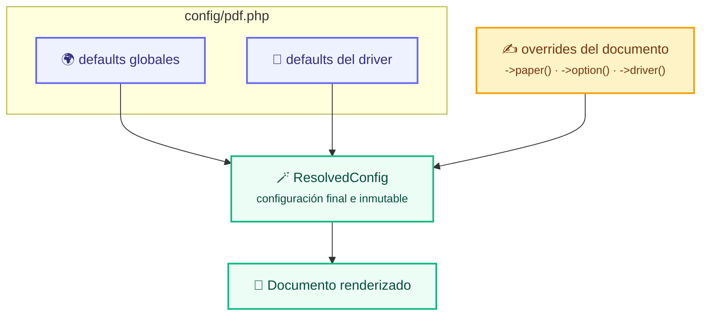

# 📄 Laravel Vellum

> **Una API. Cualquier origen. Cualquier motor. Todas las funcionalidades de conformidad.**
>
> Convierte *cualquier cosa* — una vista Blade, HTML plano, un fichero, Twig, una URL — en un PDF
> con *cualquier motor* — DOMPDF, Chromium (Browsershot), mPDF — sin reescribir tu código.
>
> **Vellum** — *el soporte donde se compone el documento*. Tú eliges el origen y el motor; Vellum
> pone el resto.

<p align="center">
  
  
  
  
  
  
</p>

<p align="center">
  
  
  
  
  
  
</p>

**Español** · [English](README.en.md)

> [!NOTE]
> **Estado:** el paquete todavía no está publicado en Packagist. Se instala como repositorio local
> (`type: path`); instrucciones en [Instalación](#3-instalación).

---

## ⚡ En 30 segundos

| # | Paso | Acción |
| :-: | --- | --- |
| 1️⃣ | **Instala** | Añade el repositorio local y ejecuta `composer update` |
| 2️⃣ | **Elige motor** | `composer require dompdf/dompdf` (o mPDF / Browsershot) |
| 3️⃣ | **Renderiza** | `Pdf::view('factura', $datos)->download('factura.pdf')` |

Añade el paquete a tu `composer.json`:

```json
{
    "repositories": [
        { "type": "path", "url": "../laravel-vellum", "options": { "symlink": true } }
    ],
    "require": {
        "laravel-vellum/laravel-vellum": "*@dev"
    }
}
```

```bash
composer update laravel-vellum/laravel-vellum
composer require dompdf/dompdf   # o mpdf/mpdf, o spatie/browsershot
php artisan vendor:publish --tag=pdf-config
```

```php
use Vellum\Facades\Pdf;

return Pdf::view('facturas.factura', ['factura' => $factura])
    ->driver('dompdf')
    ->paper('a4')
    ->download('factura.pdf');
```

> [!TIP]
> Cambia solo `->driver('dompdf')` por `->driver('mpdf')` o `->driver('browsershot')`: el resto del
> documento no cambia.

Detalle completo en [Instalación](#3-instalación) y [Primeros pasos](#4-primeros-pasos).

---

## Índice

| # | Sección | Qué encontrarás |
| --- | --- | --- |
| 1 | 🧭 [Por qué otro paquete de PDF](#1-por-qué-otro-paquete-de-pdf) | Comparación honesta con los paquetes que ya conoces |
| 2 | 🧩 [De un vistazo](#2-de-un-vistazo) | La matriz de capacidades y la arquitectura en una imagen |
| 3 | 📦 [Instalación](#3-instalación) | Repositorio local, motores, configuración, Node/Chromium, Lumen |
| 4 | 🚀 [Primeros pasos](#4-primeros-pasos) | Los cinco métodos terminales y la API fluida |
| 5 | 🗂️ [Dónde vive el paquete en tu aplicación](#5-dónde-vive-el-paquete-en-tu-aplicación) | Mapa archivo por archivo de todo lo que tocas |
| 6 | 📥 [Los orígenes](#6-los-orígenes) | 5 orígenes + el tuyo, con ejemplos reales |
| 7 | ⚙️ [Los motores](#7-los-motores) | 4 motores + el tuyo, con la librería upstream explicada |
| 8 | 🧰 [Referencia de configuración](#8-referencia-de-configuración) | `config/pdf.php` explicado clave por clave |
| 9 | 🪄 [Capas y precedencia](#9-capas-y-precedencia) | Exactamente quién gana, y por qué |
| 10 | 🧪 [Pipeline de post-procesado](#10-pipeline-de-post-procesado) | Metadatos, XMP, PDF/A-3b, adjuntos, merge, firma |
| 11 | 🍳 [Recetas](#11-recetas) | 14 recetas listas para copiar de tareas habituales |
| 12 | 🧱 [Extender el paquete](#12-extender-el-paquete) | Origen, motor y procesador propios |
| 13 | 🚨 [Errores, warnings y timeouts](#13-errores-warnings-y-timeouts) | El mapa completo de excepciones y las reglas de resiliencia |
| 14 | ✅ [Tests de tu aplicación](#14-tests-de-tu-aplicación) | El driver Fake y el registro de llamadas |
| 15 | 🗺️ [Estructura del proyecto](#15-estructura-del-proyecto) | Cada archivo de `src/` explicado |
| 16 | 🛠️ [Desarrollo y CI](#16-desarrollo-y-ci) | Comandos y la matriz |
| 17 | 🌍 [Mapa del ecosistema](#17-mapa-del-ecosistema) | Quién hace qué, y cuándo usar qué |

---

## 1. Por qué otro paquete de PDF

Hay paquetes excelentes ahí fuera. Casi todos te atan a **un solo motor**:

| Paquete | Motor | Por qué puede hacerte falta este |
| --- | --- | --- |
| [`barryvdh/laravel-dompdf`](https://github.com/barryvdh/laravel-dompdf) (~7.3k ⭐, MIT) | Solo DOMPDF | No puedes cambiar a Chromium/mPDF sin reescribir tus llamadas. |
| [`spatie/laravel-pdf`](https://github.com/spatie/laravel-pdf) (~1.05k ⭐, MIT) | Solo Browsershot | Chromium para todo es caro para facturas simples. |
| [`barryvdh/laravel-snappy`](https://github.com/barryvdh/laravel-snappy) (~2.75k ⭐, MIT) | Solo wkhtmltopdf | Necesita un binario del sistema; Qt WebKit antiguo. |
| `mpdf/mpdf` (~4.7k ⭐, **GPL-2.0**) | Solo mPDF | No es un paquete de Laravel, y la licencia es copyleft. |

**Este paquete es la capa superior a todos ellos.** Mantiene la *forma* de los paquetes que ya
conoces (una facade, un builder fluido, `->download()`) y añade las tres cosas que les faltan:

| | Superpoder | Qué te da |
| :-: | --- | --- |
| 📥 | **Un contrato de origen** | Blade, HTML, fichero, Twig, URL — y el tuyo — detrás de una interfaz. |
| ⚙️ | **Un contrato de motor** | Los motores son dependencias *opcionales*. Si falta ⇒ una excepción con el `composer require` exacto. |
| 🧪 | **Un pipeline de post-procesado** | PDF/A-3b, XMP, adjuntos ZUGFeRD/Factur-X, merge y firmas funcionan **sobre los bytes**, con todos los motores — incluido el fake. |

```mermaid
flowchart LR
    A["📥 Origen<br/><small>Blade · HTML · Fichero · Twig · URL</small>"] --> B["🧱 PdfBuilder<br/><small>API fluida e inmutable</small>"]
    B --> C["🪄 ConfigResolver<br/><small>3 capas tipadas</small>"]
    C --> D["⚙️ Driver<br/><small>dompdf · browsershot · mpdf · fake</small>"]
    D --> E["🧪 Pipeline<br/><small>XMP · PDF/A · adjuntos · merge · firma</small>"]
    E --> F["📦 PdfResult<br/><small>bytes · save · stream · download</small>"]

    classDef source fill:#eef2ff,stroke:#6366f1,stroke-width:2px,color:#312e81;
    classDef builder fill:#f5f3ff,stroke:#8b5cf6,stroke-width:2px,color:#4c1d95;
    classDef driver fill:#ecfeff,stroke:#06b6d4,stroke-width:2px,color:#164e63;
    classDef pipeline fill:#fff7ed,stroke:#f59e0b,stroke-width:2px,color:#78350f;
    classDef result fill:#ecfdf5,stroke:#10b981,stroke-width:2px,color:#064e3b;

    class A source;
    class B,C builder;
    class D driver;
    class E pipeline;
    class F result;
```



<details>
<summary>🧱 El mismo diagrama en texto (para terminal o visores sin Mermaid)</summary>

```
        ┌───────────────────── Vellum\Facades\Pdf ─────────────────────┐
        │                                                              │
        ▼                                                               ▼
   PdfManager ──▶ PdfBuilder (inmutable, fluido) ──▶ render() ──▶ PdfResult
        │                 │                          │                │
        │                 │                          ▼                ▼
        │                 │                   DriverRegistry       bytes()/save()
        │                 │                          │            stream()/download()
        │                 ▼                          ▼
        │            ConfigResolver ──▶ ResolvedConfig ──▶ Pipeline ──▶ PdfContext
        │            (3 capas de config)    (tipada)         (post-procesadores)
        ▼
   Orígenes: Blade · HTML · Fichero · Twig · URL · propios
```

</details>

---

## 2. De un vistazo

### 2.1 📥 La matriz 5 orígenes × 4 motores

Cada origen funciona con cada motor. **20 combinaciones de serie** (5 orígenes × 4 motores), más
las que añadas con tus propios contratos.

| | `dompdf` | `browsershot` | `mpdf` | `fake` |
| --- | :---: | :---: | :---: | :---: |
| 📄 `blade` (vista Blade) | ✅ | ✅ | ✅ | ✅ |
| 🧾 `html` (string HTML) | ✅ | ✅ | ✅ | ✅ |
| 📁 `file` (fichero local) | ✅ | ✅ | ✅ | ✅ |
| 🌿 `twig` (plantilla Twig) | ✅ | ✅ | ✅ | ✅ |
| 🌐 `url` (URL remota) | ✅ | ✅ | ✅ | ✅ |
| 🧩 `custom` (tu `Source`) | ✅ | ✅ | ✅ | ✅ |

### 2.2 🧰 Qué puede hacer el paquete, y dónde vive cada funcionalidad

| | Capacidad | API | Implementada en | Notas |
| :-: | --- | --- | --- | --- |
| 🎯 | Elegir motor por documento | `->driver('mpdf')` | `PdfBuilder::driver()` | Anula el driver por defecto de la config. |
| 📐 | Tamaño/orientación de página | `->paper('a4', 'landscape')` | `Config\PaperSize`, `Config\Orientation` | 8 tamaños × 2 orientaciones, validados. El papel siempre sale de aquí, no del CSS. |
| 🔤 | Fuentes (familia + fichero local) | `->font('Inter', '/ruta.ttf')` | `Support\PageHtml` | Inyecta `@font-face` en el HTML. |
| 📏 | Márgenes (mm) | `->margins(10, 10, 10, 10)` | `Config\Margins` | `@page` en DOMPDF, `SetMargins()` en mPDF, opciones Puppeteer en Chromium. |
| 🧰 | Opciones específicas del motor | `->option('isPhpEnabled', false)` | `Config\DocumentOptions` | Se pasan tal cual al motor. |
| 🏷️ | Metadatos del documento | `->metadata([...])` | `Pipeline\Processors\SetDocumentMetadata` | Título, autor, asunto, keywords, creator, custom. |
| 🧾 | Paquete XMP | `->xmp([...])`, `->xmpNamespace()` | `Pipeline\Processors\EmbedXmpMetadata` | Dublin Core + namespaces propios. |
| 🗄️ | PDF/A-3b | `->pdfa('/ruta/sRGB2014.icc')` | `Pipeline\Processors\MarkPdfA3b` | Output intent + metadatos `pdfaid`. |
| 📎 | Ficheros adjuntos | `->embedFile($ruta, $nombre, 'Data', 'text/xml')` | `Pipeline\Processors\EmbedFile` | `/Filespec` + `/EmbeddedFile`. |
| 🇪🇺 | ZUGFeRD / Factur-X | `->zugferd('/tmp/factura.xml')` | `zugferd()` + los dos processors anteriores | Atajo sobre XMP + PDF/A + adjunto. |
| 🔗 | Unir PDFs | `->merge('/tmp/portada.pdf')` | `Pipeline\Processors\MergePdfs` | Usa [`setasign/fpdi`](https://github.com/setasign/FPDI). |
| ✍️ | Firma digital | `->sign('/cert.p12', 'secreto')` | `Pipeline\Processors\AddSignature` | PKCS#7 detached, CMS/PKCS#7 DER. |
| 🧩 | Post-procesado propio | `->process(new MiProcessor())` | `Pipeline\Pipeline` | También registrable globalmente en la config. |
| ⏱️ | Protección por timeout | `->timeout(15)` | `Support\RenderGuard` | Límite duro, nunca un render infinito. |
| ⚠️ | Recolección de warnings | `->strictWarnings()` | `Support\WarningCollector` | Los warnings del motor se registran, nunca se silencian. |
| 📤 | Stream / descarga / guardado | `->stream()`, `->download()`, `->save()` | `Support\PdfResult` | Respuestas estándar de Laravel. |
| 🧪 | Dobles de test deterministas | `->driver('fake')` | `Drivers\FakeDriver` | Bytes PDF válidos, cero motores. |

### 2.3 🧭 Elige tu motor en 10 segundos

| Si necesitas… | Usa | Por qué |
| --- | :-: | --- |
| 🧾 Facturas e informes simples, sin instalar Node | `dompdf` | PHP puro, cero infraestructura. |
| 🌐 Tailwind, CSS Grid, web fonts o pixel-perfect | `browsershot` | Chromium renderiza lo que ves en el navegador. |
| 🌍 Árabe, hebreo, CJK, RTL o generar muchos PDFs | `mpdf` | Unicode y bidireccionalidad de serie. |
| 🧪 Tests rápidos y deterministas | `fake` | PDF válido, sin motor ni navegador. |

> [!TIP]
> El motor se puede fijar en la config **o** por documento con `->driver()`. Cambiar de motor no
> cambia ni el origen ni la plantilla.

---

## 3. Instalación

| Requisito | Versión |
| --- | --- |
| PHP | `^8.2` (probado en 8.2, 8.3, 8.4 y 8.5) |
| Laravel | 10, 11, 12 o 13; también Lumen |
| `ext-json` | obligatoria |
| `ext-openssl` | solo si vas a firmar documentos |
| `ext-curl` | solo si vas a usar el origen `url` |
| Node.js + Chromium | solo para el motor `browsershot` |

### 3.1 📦 El paquete en sí

El paquete **todavía no está publicado en Packagist**, así que se instala como repositorio local de
Composer. Añade el repositorio y el requisito a tu `composer.json`:

```json
{
    "repositories": [
        {
            "type": "path",
            "url": "../laravel-vellum",
            "options": { "symlink": true }
        }
    ],
    "require": {
        "laravel-vellum/laravel-vellum": "*@dev"
    }
}
```

Ajusta `url` si el paquete está en otra ruta y actualiza:

```bash
composer update laravel-vellum/laravel-vellum
```

El service provider (`Vellum\PdfServiceProvider`) y el alias de la facade
(`Pdf` → `Vellum\Facades\Pdf`) se **descubren solos** mediante la sección `extra.laravel` del
`composer.json`.

Publica el fichero de configuración (opcional pero recomendable):

```bash
php artisan vendor:publish --tag=pdf-config
```

```
Published: config/pdf.php
```

### 3.2 🔌 Los motores son opcionales — instala solo lo que uses

El paquete en sí **no depende de ningún motor de render**. Elige uno (o varios):

| Motor | `composer require` | Requisitos de sistema adicionales |
| --- | --- | --- |
| `dompdf` | `composer require dompdf/dompdf` | ninguno — PHP puro |
| `mpdf` | `composer require mpdf/mpdf` | un `tempDir` escribible |
| `browsershot` | `composer require spatie/browsershot` | **Node.js ≥ 18**, `npm`, Chromium |
| `fake` | *(nada)* | ninguno — para tests |

Extras opcionales:

```bash
composer require twig/twig            # origen Twig
composer require setasign/fpdi        # post-procesador de merge (arrastra setasign/fpdf)
```

Si eliges un motor cuyo motor no está instalado, el paquete **no falla en silencio**: lanza
`DriverNotSupportedException` con el comando `composer require` exacto que necesitas.

### 3.3 🌐 Setup de Browsershot / Chromium (la única instalación no trivial)

`spatie/browsershot` maneja Puppeteer desde Node.js:

```bash
# 1. Node.js 18+ y npm
node --version      # v18.x o superior
npm --version

# 2. Instala Puppeteer en el directorio que elijas (descarga Chromium)
npm install puppeteer

# 3. Dile al paquete dónde está todo
export BROWSERSHOT_NODE_PATH="$(command -v node)"
export BROWSERSHOT_NPM_PATH="$(command -v npm)"
export BROWSERSHOT_NODE_MODULES_PATH="/ruta/absoluta/a/node_modules"
# opcional, si Chromium está instalado en el sistema:
export BROWSERSHOT_CHROME_PATH="/usr/bin/chromium"
```

Los mismos cuatro valores se pueden fijar por motor en `config/pdf.php` — las variables de entorno
son solo el fallback:

```php
'drivers' => [
    'browsershot' => [
        'options' => [
            'node_binary' => '/usr/local/bin/node',
            'npm_binary' => '/usr/local/bin/npm',
            'node_modules_path' => base_path('node_modules'),
            'chrome_path' => '/usr/bin/chromium-browser',
        ],
    ],
],
```

> [!TIP]
> La configuración publicada ya trae `node_modules_path` apuntando a `base_path('node_modules')`:
> si instalas Puppeteer en la aplicación (`npm install puppeteer`), el driver lo encuentra solo.

### 3.4 🧩 Lumen

Lumen **no** lee la sección `extra.laravel` del `composer.json`, así que registra el provider a mano
en `bootstrap/app.php`:

```php
$app->register(Vellum\Lumen\LumenServiceProvider::class);
```

Copia el fichero de configuración a `config/pdf.php` en tu proyecto Lumen (Lumen no tiene
`vendor:publish`):

```bash
cp vendor/laravel-vellum/laravel-vellum/config/pdf.php config/pdf.php
```

---

## 4. Primeros pasos

```php
use Vellum\Facades\Pdf;

// Una vista Blade, renderizada por Chromium, A4 apaisado, descargada.
return Pdf::view('facturas.factura', ['factura' => $factura])
    ->driver('browsershot')
    ->paper('a4', 'landscape')
    ->download('factura.pdf');
```

Cada método del builder devuelve una **instancia nueva**. No se renderiza nada hasta que llamas a
un método terminal:

```php
$bytes  = Pdf::html('<h1>Hola</h1>')->bytes();    // bytes PDF crudos (string)
$path   = Pdf::html('<h1>Hola</h1>')->save('/tmp/hola.pdf');  // devuelve la ruta
$result = Pdf::html('<h1>Hola</h1>')->render();    // el objeto PdfResult completo
$stream = Pdf::html('<h1>Hola</h1>')->stream();   // StreamedResponse (inline)
$down   = Pdf::html('<h1>Hola</h1>')->download('hola.pdf');   // Response (adjunto)
```

`PdfResult` te da todo lo que necesitas tras el render:

```php
$result->bytes;        // string
$result->size();       // int, bytes
$result->md5();        // string
$result->sha256();     // string
$result->toBase64();   // string  (p. ej. para una API JSON)
$result->warnings;     // list<string> — warnings emitidos por el motor
$result->durationMs;   // float
$result->driver;       // 'dompdf' | 'browsershot' | 'mpdf' | 'fake'
$result->sourceType;   // 'blade' | 'html' | 'file' | 'twig' | 'url'
```

¿Prefieres inyección de dependencias que la facade? El manager es un singleton en el contenedor:

```php
use Vellum\PdfManager;

final class InvoiceService
{
    public function __construct(private readonly PdfManager $pdf) {}

    public function render(Invoice $invoice): string
    {
        return $this->pdf->view('facturas.factura', ['factura' => $invoice])->bytes();
    }
}
```

---

## 5. Dónde vive el paquete en tu aplicación

Esta es la lista completa de ficheros que normalmente creas o tocas. Nada más cambia.

### 5.1 🗂️ El mapa de ficheros

| Fichero | Papel | Qué escribes |
| --- | --- | --- |
| `config/pdf.php` | Configuración por capas | Se publica con `vendor:publish`; edita los defaults, las opciones por motor, los orígenes y los processors globales. |
| `routes/web.php` | Exponer el PDF | Una ruta que devuelve `->download()` / `->stream()`. |
| `app/Http/Controllers/InvoiceController.php` | Acción del controlador | Inyecta `PdfManager` o usa la facade `Pdf`. |
| `app/Services/Pdf/InvoicePdf.php` | *(opcional)* Servicio de dominio | Envuelve la definición del documento para que los controladores queden finos. |
| `resources/views/facturas/factura.blade.php` | La plantilla | HTML + CSS planos. Reutiliza tus componentes actuales. |
| `resources/views/pdf/layout.blade.php` | *(opcional)* Layout | `@page`, fuentes y build de Tailwind compartidos. |
| `app/Pdf/Processors/WatermarkProcessor.php` | *(opcional)* Processor propio | Una clase que implemente `Vellum\Contracts\Processor`. |
| `app/Providers/AppServiceProvider.php` | Registrar motores propios | `Pdf::extend('wkhtml', fn () => new WkHtmlDriver)`. |
| `tests/Feature/InvoicePdfTest.php` | Tests sin motores | `->driver('fake')` + `Pdf::fakeDriver()->calls()`. |
| `resources/pdf/sRGB2014.icc` | *(opcional)* Perfil de color PDF/A | El perfil ICC que usa `->pdfa()`. |

### 5.2 🛣️ Una ruta

```php
// routes/web.php
use Vellum\Facades\Pdf;

Route::get('/facturas/{factura}/pdf', function (Invoice $factura) {
    return Pdf::view('facturas.factura', ['factura' => $factura])
        ->driver('browsershot')
        ->metadata(['title' => 'Factura '.$factura->numero])
        ->download('factura-'.$factura->numero.'.pdf');
})->name('facturas.pdf');
```

### 5.3 🎛️ Un controlador

```php
// app/Http/Controllers/InvoiceController.php
use Illuminate\Http\Response;
use Vellum\Facades\Pdf;

final class InvoiceController extends Controller
{
    public function show(Invoice $invoice): Response
    {
        return Pdf::view('facturas.factura', ['factura' => $invoice])
            ->paper('a4')
            ->margins(12, 12, 12, 12)
            ->filename('factura.pdf')
            ->download();
    }
}
```

### 5.4 🧰 Un servicio dedicado (recomendado si lo reutilizas)

```php
// app/Services/Pdf/InvoicePdf.php
use Vellum\PdfBuilder;
use Vellum\PdfManager;

final class InvoicePdf
{
    public function __construct(private readonly PdfManager $pdf) {}

    public function build(Invoice $invoice): PdfBuilder
    {
        return $this->pdf
            ->view('facturas.factura', ['factura' => $invoice])
            ->driver(config('pdf.default_driver'))
            ->paper('a4')
            ->metadata([
                'title' => 'Factura '.$invoice->numero,
                'author' => config('app.name'),
                'subject' => 'Vencimiento '.$invoice->vencimiento->toDateString(),
                'keywords' => 'factura, facturación',
            ]);
    }
}
```

Ahora todos los llamantes comparten la misma definición:

```php
InvoicePdf::class, fn ($s) => $s->build($invoice)->download('factura.pdf');
InvoicePdf::class, fn ($s) => $s->build($invoice)->save($ruta);
```

### 5.5 📄 La plantilla Blade

La plantilla es HTML plano. Usa las mismas vistas que ya tienes:

```blade
{{-- resources/views/facturas/factura.blade.php --}}
<!DOCTYPE html>
<html lang="es">
<head>
    <meta charset="utf-8">
    <title>Factura {{ $factura->numero }}</title>
    <style>
        /* El papel y la orientación los decide el documento (->paper()), no el CSS. */
        body { font-family: "DejaVu Sans", sans-serif; font-size: 12px; }
        table { width: 100%; border-collapse: collapse; }
        th, td { border-bottom: 1px solid #ddd; padding: 6px; text-align: left; }
        .total { font-weight: bold; font-size: 15px; }
    </style>
</head>
<body>
    <h1>Factura {{ $factura->numero }}</h1>
    <table>
        <thead><tr><th>Concepto</th><th>Cantidad</th><th>Precio</th></tr></thead>
        <tbody>
        @foreach ($factura->lineas as $linea)
            <tr>
                <td>{{ $linea->concepto }}</td>
                <td>{{ $linea->cantidad }}</td>
                <td>{{ number_format($linea->precio, 2) }} €</td>
            </tr>
        @endforeach
        </tbody>
    </table>
    <p class="total">Total: {{ number_format($factura->total, 2) }} €</p>
</body>
</html>
```

> [!TIP]
> El paquete inyecta `<style>@page{margin:…}</style>` (DOMPDF), `font-family` y las reglas
> `@font-face` por ti cuando llamas a `->margins()` / `->font()`. No hace falta que escribas
> `@page`.
>
> [!IMPORTANT]
> **El papel siempre sale del documento** (`->paper()`, `->orientation()` o `config/pdf.php`),
> nunca de la plantilla. Las declaraciones `@page { size: … }` que dejes en el CSS se **descartan**
> antes de llegar al motor, porque cada motor las lee de forma distinta: mPDF interpreta un
> nombre de papel como una página de tamaño cero (y el maquetado se rompe), DOMPDF deja que la
> plantilla sustituya al documento y Chromium las ignora. Si una plantilla declara un tamaño
> que **no** coincide con el configurado, el motor emite un aviso —visible en
> `$resultado->warnings`— en lugar de cambiar el papel en silencio.

### 5.6 🔌 Registrar un motor propio (service provider)

```php
// app/Providers/AppServiceProvider.php
use Illuminate\Support\ServiceProvider;
use Vellum\Facades\Pdf;

final class AppServiceProvider extends ServiceProvider
{
    public function boot(): void
    {
        Pdf::extend('wkhtml', fn () => new WkHtmlDriver);
    }
}
```

### 5.7 ✅ Tests

```php
// tests/Feature/InvoicePdfTest.php
use Vellum\Facades\Pdf;

public function test_the_invoice_route_returns_a_pdf(): void
{
    $this->actingAs($user)
        ->get(route('facturas.pdf', $factura))
        ->assertOk()
        ->assertHeader('content-type', 'application/pdf');
}

public function test_the_invoice_is_rendered_by_the_fake_driver(): void
{
    $bytes = Pdf::view('facturas.factura', ['factura' => $factura])->driver('fake')->bytes();

    $this->assertStringStartsWith('%PDF-', $bytes);
}
```

---

## 6. Los orígenes

Un **origen** responde a una pregunta: *¿de dónde sale el HTML?* Cada uno es una clase pequeña
que implementa `Vellum\Contracts\Source`.

```php
Pdf::html('<h1>Hola</h1>');                            // HTML plano
Pdf::view('facturas.factura', ['factura' => $factura]); // vista Blade
Pdf::file('/var/www/factura.html');                     // fichero local
Pdf::twig('factura.twig', ['total' => 99]);            // plantilla Twig
Pdf::url('https://example.com/factura');               // URL remota
Pdf::from(new MiSourcePersonalizado());                 // el tuyo
```

### 6.1 📄 `blade` — vistas Blade

**Para qué sirve:** todos los documentos que ya viven en tu aplicación: facturas, contratos,
informes, etiquetas. Usa el *mismo* view factory que las respuestas HTTP, así que los componentes,
`@include`, `@each`, las traducciones y los view composers funcionan.

```php
use Vellum\Facades\Pdf;

return Pdf::view('facturas.factura', [
    'factura' => $factura,
    'empresa' => auth()->user()->empresa,
])->download('factura.pdf');
```

| Comportamiento | Detalle |
| --- | --- |
| Resolución de vistas | `Illuminate\Contracts\View\Factory` desde el contenedor. |
| Vista inexistente | `SourceNotFoundException::missingView()` — *no* un 500. |
| Error de render | Envuelto en `SourceNotFoundException` con el mensaje original. |
| Motor propio | `Pdf::from(BladeSource::make($view, $data, 'php'))` fuerza el motor PHP. |

> [!NOTE]
> `Illuminate\View` es un requisito duro del paquete (`illuminate/view` está en `require`).

### 6.2 🧾 `html` — HTML plano

**Para qué sirve:** HTML construido al vuelo, HTML que viene de un CMS o de una API, o una
plantilla compilada por otro sistema.

```php
$html = view('emails.factura', $data)->render();   // cualquier productor de HTML

$bytes = Pdf::html($html)->paper('a5')->bytes();
```

Sin intermediarios: el string se usa tal cual.

### 6.3 📁 `file` — fichero local

**Para qué sirve:** plantillas HTML estáticas que se distribuyen con la aplicación, informes
exportados, o ficheros generados por otro proceso.

```php
Pdf::file('resources/pdf/condiciones.html');          // relativo a base_path()
Pdf::file('/var/www/exports/informe.html');             // absoluto
Pdf::file('file:///var/www/exports/informe.html');      // el prefijo file:// se quita
```

Las rutas relativas se resuelven contra `base_path()`, así que el mismo código funciona en todos los
entornos. Los ficheros ilegibles lanzan `SourceNotFoundException::missingFile()`.

### 6.4 🌿 `twig` — plantillas Twig

**Para qué sirve:** equipos que vienen de Symfony, o proyectos que quieren un motor de plantillas
sin dependencias de Laravel. Usa [`twig/twig`](https://github.com/twigphp/Twig) (~8.4k ⭐, BSD-3).

Upstream, en PHP puro:

```php
use Twig\Environment;
use Twig\Loader\FilesystemLoader;

$twig = new Environment(new FilesystemLoader('/path/to/templates'));
echo $twig->render('index.html.twig', ['the' => 'variables']);
```

En este paquete las rutas del loader y la extensión se configuran una vez, y la plantilla se
resuelve por nombre:

```php
// config/pdf.php
'sources' => [
    'twig' => [
        'paths' => [resource_path('views'), base_path('resources/twig')],
        'extension' => 'twig',
    ],
],
```

```php
// resources/views/factura.twig
Pdf::twig('factura', ['factura' => $factura])->download('factura.pdf');
```

`Pdf::twig('factura')` prueba `factura.twig` primero y luego `factura` — en todas las rutas
configuradas, en orden. Las plantillas inexistentes lanzan `SourceNotFoundException::missingFile()`;
un error de Twig en runtime se envuelve con el mensaje original. `twig/twig` es una dependencia
opcional: sin ella obtienes `SourceNotFoundException::missingLibrary('twig/twig', 'twig')`.

### 6.5 🌐 `url` — URL remota

**Para qué sirve:** imprimir una página web, una factura alojada en otro sistema o el recibo de un
portal.

```php
Pdf::url('https://billing.example.com/factura/42')->download('factura.pdf');
```

Detalles de implementación (todos configurables en `config/pdf.php` → `sources.url`):

| Comportamiento | Detalle |
| --- | --- |
| Protocolo | Solo `http` y `https`; cualquier otro se rechaza. |
| Redirecciones | Se siguen, hasta 5. |
| Timeout | `sources.url.timeout` (15 s por defecto), timeout de conexión limitado a 10 s. |
| Cabeceras | `sources.url.headers` — p. ej. una cabecera `Authorization` para una página privada. |
| User agent | `Vellum/1.0`. |
| Interruptor | `sources.url.allow_remote => false` desactiva globalmente los orígenes remotos. |
| Errores | Estado no-2xx o fallo de transporte ⇒ `SourceNotFoundException::missingUrl()`. |

```php
'sources' => [
    'url' => [
        'allow_remote' => true,
        'timeout' => 15,
        'headers' => [
            'Authorization' => 'Bearer '.config('services.billing.token'),
        ],
    ],
],
```

> [!NOTE]
> `ext-curl` es necesario para este origen; sin él obtienes
> `SourceNotFoundException::missingLibrary('ext-curl', 'url')`.

### 6.6 🧩 Escribir tu propio origen

```php
use Vellum\Config\ResolvedConfig;
use Vellum\Contracts\Source;

final class CsvSource implements Source
{
    public function __construct(private readonly string $path) {}

    public function type(): string
    {
        return 'csv';
    }

    public function describe(): string
    {
        return $this->path;
    }

    public function load(ResolvedConfig $config): string
    {
        $rows = array_map('str_getcsv', file($this->path, FILE_IGNORE_NEW_LINES));

        $html = '<table><tr><th>'.implode('</th><th>', array_shift($rows)).'</th></tr>';

        foreach ($rows as $row) {
            $html .= '<tr><td>'.implode('</td><td>', array_map('e', $row)).'</td></tr>';
        }

        return $html.'</table>';
    }
}
```

```php
Pdf::from(new CsvSource('/tmp/filas.csv'))->download('filas.pdf');
```

---

## 7. Los motores

Un **motor** responde a una pregunta: *¿qué motor convierte el HTML en bytes?*

```php
Pdf::html('<p>x</p>')->driver('mpdf');
```

| Motor | Motor real | Licencia del motor | Instalación | Uso típico |
| --- | --- | --- | --- | --- |
| `dompdf` | [`dompdf/dompdf`](https://github.com/dompdf/dompdf) (~11.2k ⭐, v3.1.6) | **LGPL-2.1** | `composer require dompdf/dompdf` | Documentos simples, sin infraestructura, CI amigable |
| `browsershot` | [`spatie/browsershot`](https://github.com/spatie/browsershot) (~5.2k ⭐, v5.4.1) | MIT | `composer require spatie/browsershot` + Node/Chromium | CSS moderno, Tailwind, web fonts, gráficos |
| `mpdf` | [`mpdf/mpdf`](https://github.com/mpdf/mpdf) (~4.7k ⭐, v8.3.1) | **GPL-2.0** ⚠️ | `composer require mpdf/mpdf` | UTF-8, idiomas RTL, códigos de barras, generación masiva |
| `fake` | *(integrado)* | MIT | — | Tests y CI sin motores |

> [!WARNING]
> **Licencias:** mPDF es GPL-2.0 (copyleft) y DOMPDF es LGPL-2.1. Si distribuyes una
> aplicación de código cerrado, lee esas licencias: que el *wrapper* sea MIT no cambia los términos
> del motor. `browsershot` (MIT) no tiene esa restricción.

### 7.1 🐘 `dompdf` — el motor PHP puro

**Upstream, en PHP puro:**

```php
use Dompdf\Dompdf;

$dompdf = new Dompdf();
$dompdf->loadHtml('hello world');
$dompdf->setPaper('A4', 'landscape');
$dompdf->render();
$dompdf->stream();
```

**Para qué sirve DOMPDF:** HTML → PDF enteramente en PHP. Sin Node, sin Chromium, sin binarios del
sistema. Es el default pragmático para facturas, informes y etiquetas.

**En este paquete:**

```php
use Vellum\Facades\Pdf;

return Pdf::view('facturas.factura', ['factura' => $factura])
    ->driver('dompdf')
    ->paper('a4', 'portrait')
    ->margins(15, 15, 15, 15)
    ->download('factura.pdf');
```

Lo que el driver hace por ti:

| Aspecto | Tratamiento |
| --- | --- |
| Papel y orientación | `Dompdf::setPaper($paper, $orientation)` |
| Márgenes | Inyectados como `@page{margin:…}` (DOMPDF no tiene API de márgenes) |
| Familia de fuente | Inyectada como `html,body{font-family:…}` |
| Fichero de fuente | Inyectado como `@font-face{…}` (el fichero debe existir en local) |
| Assets remotos | Desactivados salvo `->allowRemoteAssets()` — `isRemoteEnabled` es el vector SSRF clásico de DOMPDF |
| PHP dentro del HTML | Desactivado (`isPhpEnabled = false`) — nunca lo actives con contenido de usuario |
| JavaScript | Desactivado (`isJavascriptEnabled = false`) |
| Ruta base | `->option('base_path', '/var/www')` para imágenes relativas |
| Opciones del motor | Todo lo que haya en `options` / `->option()` va a `Options::set()` |

Claves reales de `Options` de DOMPDF que puedes reenviar (camelCase, como upstream):

```php
'drivers' => [
    'dompdf' => [
        'options' => [
            'isRemoteEnabled' => false,
            'allowedRemoteHosts' => ['api.example.com'],
            'isPhpEnabled' => false,
            'isHtml5ParserEnabled' => true,
            'isFontSubsettingEnabled' => true,
            'defaultFont' => 'DejaVu Sans',
            'defaultPaperSize' => 'a4',
            'defaultPaperOrientation' => 'portrait',
            'dpi' => 96,
            'fontHeightRatio' => 1.1,
            'chroot' => '/var/www',
            'allowedProtocols' => ['data://', 'file://', 'http://', 'https://'],
            'tempDir' => '/var/tmp',
            'fontDir' => '/var/cache/fonts',
            'logOutputFile' => '/var/log/dompdf.log',
            'artifactPathValidation' => true,
        ],
    ],
],
```

**Qué soporta DOMPDF** (upstream): parser HTML5, CSS 2.1 + un subconjunto de CSS 3 (`@page`,
`page-break-*`, flexbox parcialmente), imágenes (JPEG/PNG/GIF/BMP/SVG), `@font-face` con fuentes
locales, UTF-8, bordes, tablas, formularios.
**Qué no soporta:** JavaScript, CSS Grid, custom properties, flexbox completo, documentos pesados
(es lento con miles de elementos).

### 7.2 🌐 `browsershot` — Chromium vía Puppeteer

**Upstream, en PHP puro:**

```php
use Spatie\Browsershot\Browsershot;

// se guardará un pdf (la extensión decide)
Browsershot::url('https://example.com')->save('example.pdf');
Browsershot::html('<h1>Hello world!!</h1>')->save('example.pdf');
Browsershot::htmlFromFilePath('/local/path/to/file.html')->save('example.pdf');
```

**Para qué sirve Browsershot:** renderizado pixel-perfect de *todo lo que un navegador puede
mostrar*: CSS Grid, flexbox, custom properties, Tailwind, web fonts, SVG, gráficos en canvas, fonts
desde un CDN.

**En este paquete:**

```php
use Vellum\Facades\Pdf;

return Pdf::view('informes.dashboard', ['metricas' => $metricas])
    ->driver('browsershot')
    ->paper('a4', 'landscape')
    ->allowRemoteAssets()      // web fonts e imágenes de CDN
    ->option('scale', 0.9)
    ->option('pageRanges', '1-3')
    ->option('tagged', true)
    ->download('informe.pdf');
```

Cómo el driver traduce los ajustes del paquete a Puppeteer:

| Ajuste del paquete | Opción de Puppeteer |
| --- | --- |
| `->paper('a4')` | `format` = `A4` |
| `->orientation('landscape')` | `landscape` = `true` |
| `->margins(10, 10, 10, 10)` (mm) | `marginTop/Bottom/Left/Right` (convertidos a pulgadas) |
| `->timeout(15)` | `Browsershot::timeout(15)` — aborta el render |
| `->option('printBackground', true)` | se reenvía tal cual |

Todas las opciones de impresión de Puppeteer funcionan porque se reenvían tal cual:
`printBackground`, `displayHeaderFooter`, `headerTemplate`, `footerTemplate`,
`preferCSSPageSize`, `landscape`, `scale`, `pageRanges`, `format`, `margin`, `width`, `height`,
`tagged`, `outline`, `omitBackground`, `waitForFonts`.

Hay cuatro claves de opción **reservadas** por el driver (configuran el motor, no la página):

```php
->option('node_binary', '/usr/local/bin/node')
->option('npm_binary', '/usr/local/bin/npm')
->option('node_modules_path', '/var/www/node_modules')
->option('chrome_path', '/usr/bin/chromium')
```

Si no se indican, caen a `BROWSERSHOT_NODE_PATH`, `BROWSERSHOT_NPM_PATH`,
`BROWSERSHOT_NODE_MODULES_PATH` y `BROWSERSHOT_CHROME_PATH`.

**Trade-offs:** la mayor fidelidad, pero necesita Node.js + Chromium en tu imagen de runtime, es más
lento y consume mucha más memoria que los motores PHP.

### 7.3 🌍 `mpdf` — rápido y centrado en Unicode

**Upstream, en PHP puro:**

```php
use Mpdf\Mpdf;

$mpdf = new \Mpdf\Mpdf();
$mpdf->WriteHTML('<h1>Hello world!</h1>');
$mpdf->Output();
```

**Para qué sirve mPDF:** generar *muchos* PDFs rápido con excelente soporte Unicode (CJK, árabe,
hebreo, devanagari), maquetación RTL, códigos de barras, marcas de agua y protección embebida.

**En este paquete:**

```php
use Vellum\Facades\Pdf;

return Pdf::view('facturas.factura', ['factura' => $factura])
    ->driver('mpdf')
    ->paper('a4')
    ->margins(10, 10, 15, 10)
    ->option('mode', 'utf-8')
    ->option('allow_charset_conversion', true)
    ->option('autoScriptToLang', true)
    ->option('autoLangToFont', true)
    ->download('factura.pdf');
```

Traducción que hace el driver:

| Ajuste del paquete | mPDF |
| --- | --- |
| `->paper('a4')` | constructor `format` = `A4` |
| `->orientation('landscape')` | constructor `orientation` = `L` |
| `->dpi(150)` | constructor `dpi` |
| `->margins(t, r, b, l)` | `SetMargins(left, right, top)` + `SetAutoPageBreak(true, bottom)` |
| `->font('DejaVu Sans')` | constructor `default_font` |
| `->option('tempDir', …)` | constructor `tempDir` |
| `->option('fontDir', …)` | constructor `fontDir` |

> [!WARNING]
> mPDF no lee el tamaño de página del CSS (`@page { size: … }`): un nombre de papel se
> interpreta como una página de tamaño cero y el maquetado se rompe. El driver descarta esa
> declaración y el papel sale del constructor (`format` + `orientation`), que es lo que
> garantiza que el documento tenga el mismo tamaño en todos los motores.

Todas las demás claves del constructor de mPDF también funcionan (`mode`, `format`,
`default_font_size`, `margin_*`, `tempDir`, `fontDir`, `fontdata`, `allow_charset_conversion`,
`ignore_invalid_utf8`, `autoScriptToLang`, `autoLangToFont`, `autoArabic`, `autoVietnamese`,
`biDirectional`, `baseScript`, `useSubstitutions`, `dpi`, `img_dpi`, `PDFA`, `PDFAauto`,
`ICCProfile`, `mirrorMargins`, `defaultPagebreakType`, `setAutoTopMargin`, `setAutoBottomMargin`,
`aliasNbPg`, `defaultCSS`, `curlTimeout`, `debug`, `showImageErrors`, `whitelistStreamWrappers`,
`exposeVersion`, …).

> [!NOTE]
> El paquete siempre aplica los márgenes con `SetMargins()`, por lo que las claves `margin_*` del
> constructor de mPDF quedan sobrescritas por `->margins()`.

**Trade-offs:** consume mucha memoria (mantiene el documento entero en memoria), necesita un
`tempDir` escribible y su licencia **GPL-2.0** importa en productos de código cerrado.

### 7.4 🧪 `fake` — el doble de test

**Para qué sirve:** tests unitarios y funcionales que no deben depender de un navegador, una caché
de fuentes o una librería nativa — y bytes deterministas para comparar.

```php
$bytes = Pdf::view('facturas.factura')->driver('fake')->bytes();

$this->assertStringStartsWith('%PDF-', $bytes);
```

El driver fake **resuelve igualmente el origen**, así que una vista ausente o una URL inalcanzable
hacen fallar el test igual que en producción. Registra cada llamada:

```php
$calls = Pdf::fakeDriver()->calls();

// [
//   ['source' => 'blade', 'description' => 'facturas.factura', 'driver' => 'fake',
//    'paper' => 'a4', 'orientation' => 'portrait'],
// ]

Pdf::fakeDriver()->reset();
```

### 7.5 🧱 Escribir tu propio motor

```php
use Vellum\Config\ResolvedConfig;
use Vellum\Contracts\Capability;
use Vellum\Contracts\Driver;
use Vellum\Contracts\Source;

final class MyDriver implements Driver
{
    public function name(): string
    {
        return 'my-engine';
    }

    public function render(Source $source, ResolvedConfig $config): string
    {
        $html = $source->load($config);

        return (new MyEngine)->convert($html, [
            'paper' => $config->paper->label(),
            'orientation' => $config->orientation->value,
        ]);
    }

    public function capabilities(): array
    {
        return [Capability::XMP, Capability::METADATA];
    }

    public function supports(string $capability): bool
    {
        return in_array($capability, $this->capabilities(), true);
    }
}
```

```php
Pdf::register(new MyDriver);                 // se registra bajo su propio name()
Pdf::extend('other', fn () => new MyDriver); // se registra bajo "other", creado de forma perezosa
```

Las capacidades que declara un motor se **comprueban** antes de ejecutar la capa de post-procesado:
pedir un PDF/A a un motor que no lo soporta lanza
`DriverNotSupportedException::missingCapability()` en vez de producir un fichero roto.

---

## 8. Referencia de configuración

`config/pdf.php` — publícalo con `php artisan vendor:publish --tag=pdf-config`.

```php
<?php

use Vellum\Config\PaperSize;

return [

    /*
    | Driver por defecto
    */
    'default_driver' => env('PDF_DRIVER', 'dompdf'),

    /*
    | Defaults globales
    */
    'defaults' => [
        'paper' => PaperSize::A4->value,
        'orientation' => 'portrait',
        'font' => null,
        'font_file' => null,
        'dpi' => 96,
        'margins' => [
            'top' => 10.0,
            'right' => 10.0,
            'bottom' => 10.0,
            'left' => 10.0,
        ],
        'temp_folder' => null,
        'font_cache_path' => null,
        'allow_remote_assets' => false,
        'timeout' => 30,
        'fail_on_warnings' => false,
        'options' => [],
    ],

    /*
    | Defaults por driver
    */
    'drivers' => [
        'dompdf' => [
            'options' => [
                'isHtml5ParserEnabled' => true,
                'isPhpEnabled' => false,
                'isJavascriptEnabled' => false,
            ],
        ],
        'browsershot' => [
            'options' => [
                'printBackground' => true,
                'scale' => 1,
                'preferCSSPageSize' => false,
            ],
        ],
        'mpdf' => ['options' => []],
        'fake' => ['options' => []],
    ],

    /*
    | Orígenes
    */
    'sources' => [
        'twig' => [
            'paths' => [function_exists('resource_path') ? resource_path('views') : base_path('resources/views')],
            'extension' => 'twig',
        ],
        'url' => [
            'allow_remote' => true,
            'timeout' => 15,
            'headers' => [],
        ],
    ],

    /*
    | Post processors (se resuelven desde el contenedor)
    */
    'processors' => [
        // App\Pdf\Processors\WatermarkProcessor::class,
    ],

    /*
    | Logging
    */
    'logging' => [
        'channel' => null,
        'level' => 'info',
    ],
];
```

### 8.1 🔑 Cada clave, explicada

| Clave | Tipo | Por defecto | Significado |
| --- | --- | --- | --- |
| `default_driver` | `string` | `env('PDF_DRIVER', 'dompdf')` | Motor usado cuando un documento no elige ninguno. |
| `defaults.paper` | `string` | `'a4'` | Uno de `a3 a4 a5 b5 letter legal tabloid executive`. |
| `defaults.orientation` | `string` | `'portrait'` | `portrait` o `landscape`. |
| `defaults.font` | `?string` | `null` | Familia de fuente por defecto, inyectada en el HTML. |
| `defaults.font_file` | `?string` | `null` | Ruta a un TTF/OTF local, inyectado como `@font-face`. |
| `defaults.dpi` | `int` | `96` | Resolución. |
| `defaults.margins` | `array{top,right,bottom,left}` | `10.0` cada uno | Milímetros. |
| `defaults.temp_folder` | `?string` | `null` | Temporal escribible para el motor (fuentes, imágenes). |
| `defaults.font_cache_path` | `?string` | `null` | Caché de fuentes (DOMPDF `fontDir`, mPDF `fontDir`). |
| `defaults.allow_remote_assets` | `bool` | `false` | Si el motor puede descargar imágenes/CSS remotas. |
| `defaults.timeout` | `int` | `30` | Segundos máximos de un render. |
| `defaults.fail_on_warnings` | `bool` | `false` | Convertir los warnings del motor en excepciones. |
| `defaults.options` | `array` | `[]` | Opciones del motor aplicadas a **todos** los drivers. |
| `drivers.<nombre>.options` | `array` | `[]` | Opciones del motor para un solo driver. |
| `sources.twig.paths` | `list<string>` | `[resources/views]` | Directorios que recorre el origen Twig. |
| `sources.twig.extension` | `string` | `'twig'` | Extensión que se prueba primero (`nombre.twig`, luego `nombre`). |
| `sources.url.allow_remote` | `bool` | `true` | Interruptor general del origen URL. |
| `sources.url.timeout` | `int` | `15` | Timeout HTTP en segundos. |
| `sources.url.headers` | `array<string,string>` | `[]` | Cabeceras HTTP adicionales. |
| `processors` | `list<class-string>` | `[]` | Post processors globales, resueltos desde el contenedor. |
| `logging.channel` | `?string` | `null` | Canal de log; `null` = el canal por defecto de la aplicación. |
| `logging.level` | `string` | `'info'` | Nivel declarado para los eventos del paquete. El paquete emite `info` (render) y `warning` (warnings del motor); fija el nivel mínimo del canal en `config/logging.php`. |

### 8.2 🛡️ Tipado estricto, nunca conversiones silenciosas

Cada valor se lee con lectores tipados. Un tipo incorrecto lanza `InvalidConfigurationException`
en vez de convertirse a la fuerza:

```php
'dpi' => 96,              // ✅ int
'dpi' => '96',            // ✅ string numérico → 96
'dpi' => 'muchos',        // ❌ InvalidConfigurationException: "dpi" must be an integer

'fail_on_warnings' => true,    // ✅ bool
'fail_on_warnings' => 'yes',   // ✅ "1" "true" "yes" "on" → true
'fail_on_warnings' => 'quizá', // ❌ InvalidConfigurationException: "fail_on_warnings" must be a boolean

'orientation' => 'diagonal',   // ❌ InvalidConfigurationException: unsupported orientation
'paper' => 'A4',               // ✅ no distingue mayúsculas
```

Las únicas conversiones implícitas son las que no pueden ser ambiguas: strings numéricos a enteros
y los strings de booleanos bien conocidos que se listan arriba.

---

## 9. Capas y precedencia

Tres capas, un ganador:



<details>
<summary>🧱 La precedencia en texto</summary>

```
        config/pdf.php                 config/pdf.php            tu código
        'defaults'                     'drivers.<nombre>'        ->paper(), ->option()...
              │                                │                        │
              └──────────────┬─────────────────┘                        │
                             ▼                                          ▼
              defaults globales  <  defaults del driver  <  overrides del documento
```

</details>

| Ajuste | Global | Driver | Documento |
| --- | :---: | :---: | :---: |
| `paper`, `orientation`, `font`, `dpi`, `margins`, `timeout`, `fail_on_warnings`, … | ✅ | ✅ | ✅ |
| Opciones `options` del motor | ✅ | ✅ | ✅ (se fusionan al final) |

Las opciones del motor se **fusionan**, no se sustituyen: `defaults.options` +
`drivers.x.options` + las llamadas `->option()`. El nivel de documento siempre gana.

```php
// config
'drivers' => ['dompdf' => ['options' => ['dpi' => 150, 'defaultFont' => 'DejaVu Sans']]],

// documento
Pdf::html('<p>x</p>')->option('dpi', 300)->render();
// → dpi = 300, defaultFont = 'DejaVu Sans'
```

Dos valores derivados vienen siempre del **documento**, nunca de las opciones, porque definen el
lienzo de página: el tamaño de papel y la orientación.

---

## 10. Pipeline de post-procesado

Los post-procesadores se ejecutan **después** de que el motor produjo los bytes. Eso es lo que hace
que PDF/A, XMP, adjuntos, merge y firmas funcionen con *todos* los motores — incluido `fake`.

El orden es fijo e intencionado:

```mermaid
flowchart LR
    R["📄 render()"] --> M["🏷️ /Info"] --> X["🧾 XMP"] --> A["🗄️ PDF/A-3b"]
    A --> E["📎 Adjuntos"] --> G["🔗 Merge"] --> P["🧩 Tus processors"] --> S["✍️ Firma"] --> O["📦 PDF final"]

    classDef step fill:#f5f3ff,stroke:#8b5cf6,stroke-width:2px,color:#4c1d95;
    classDef end fill:#ecfdf5,stroke:#10b981,stroke-width:2px,color:#064e3b;
    class R,M,X,A,E,G,P,S step;
    class O end;
```

| Paso | Processor | Qué escribe |
| --- | --- | --- |
| 0 | *tus processors globales* | `config('pdf.processors')`, resueltos desde el contenedor. |
| 1 | `SetDocumentMetadata` | Diccionario `/Info` (título, autor, asunto, keywords, creator, producer, custom). |
| 2 | `EmbedXmpMetadata` | Stream `/Metadata` con un paquete XMP (Dublin Core + namespaces propios). |
| 2' | `MarkPdfA3b` | XMP + `/OutputIntent` + `pdfaid:part=3`, `pdfaid:conformance=B` + `/ID` estable. |
| 3 | `EmbedFile` | `/Filespec` + `/EmbeddedFile` + entrada del árbol `/Names`. |
| 4 | `MergePdfs` | Concatena otros PDFs con [`setasign/fpdi`](https://github.com/setasign/FPDI). |
| 5 | *tu* `Processor` | Lo que quieras. |
| 6 | `AddSignature` | Diccionario `/Sig` + `/ByteRange` + firma PKCS#7 detached. |

### 10.1 🏷️ Metadatos

```php
Pdf::view('facturas.factura')
    ->metadata([
        'title' => 'Factura 2026/0042',
        'author' => 'ACME S.L.',
        'subject' => 'Vencimiento 2026-02-01',
        'keywords' => 'factura, facturación, 2026',
        'creator' => 'App de facturación',
        'producer' => 'Vellum',
        'language' => 'es-ES',
        'creation_date' => 'D:20260115120000+00\'00\'',
        // cualquier otra clave se escribe como entrada custom del diccionario /Info
        'numero_factura' => '2026/0042',
    ])
    ->download();
```

Las claves reconocidas son `title`, `author`, `subject`, `keywords`, `creator`, `producer`,
`creation_date`, `modification_date` y `language`. **Cualquier otra clave se escribe como entrada
custom** — no existe un array `custom` anidado.

El diccionario `/Info` y el paquete XMP se escriben desde la misma fuente de verdad, así que nunca
se contradicen.

### 10.2 🧾 XMP

```php
Pdf::view('informes.mensual')
    ->xmp([
        'dc:title' => 'Informe mensual',
        'dc:creator' => ['Acme Analytics'],
        'custom:departamento' => 'Finanzas',
    ])
    ->xmpNamespace('custom', 'https://example.com/ns/custom/')
    ->download();
```

### 10.3 🗄️ PDF/A-3b

```php
Pdf::view('facturas.factura')
    ->pdfa(resource_path('pdf/sRGB2014.icc'))
    ->download('factura.pdf');
```

Qué hace:

- escribe la identificación XMP `pdfaid:part=3` / `pdfaid:conformance=B`,
- embebe el **output intent ICC** (`/OutputIntent` con `/S /GTS_PDFA1`,
  `/OutputConditionIdentifier` = `sRGB IEC61966-2.1`),
- normaliza el `/ID` del trailer a un identificador estable y determinista.

Dónde conseguir el perfil ICC: `sRGB2014.icc` lo distribuyen la PDF Association,
[`atgp/factur-x`](https://github.com/atgp/factur-x) y la mayoría de distribuciones de Ghostscript
(`srgb.icc`, `default_rgb.icc`). **veraPDF** es el validador, no la fuente del perfil:

```bash
verapdf --flavour pdfa-3b factura.pdf
```

> [!IMPORTANT]
> Sin perfil ICC el `/OutputIntent` **no** se escribe: la identificación `pdfaid` sí se añade, pero
> un validador PDF/A-3b estricto señalará que falta el output intent. Pasa siempre un perfil para
> documentos de archivo.

### 10.4 📎 Ficheros adjuntos y ZUGFeRD / Factur-X

```php
// Adjunto genérico
Pdf::view('facturas.factura')
    ->embedFile('/tmp/pedido.xml', 'pedido.xml', 'Data', 'application/xml')
    ->download();

// Factura híbrida (ZUGFeRD 2.x / Factur-X)
Pdf::view('facturas.factura')
    ->zugferd('/tmp/factur-x.xml', [
        'document_type' => 'INVOICE',
        'conformance_level' => 'EN 16931',
        'version' => '1.0',
        'profile' => 'urn:factur-x:pdfa:CrossIndustryDocument:invoice:1p0#',
    ])
    ->download('factura.pdf');
```

`->zugferd()` es un atajo que hace tres cosas a la vez:

| Efecto | Valor |
| --- | --- |
| Namespace XMP | `fx` → `urn:factur-x:pdfa:CrossIndustryDocument:invoice:1p0#` |
| Propiedades XMP | `fx:DocumentType`, `fx:DocumentFileName`, `fx:ConformanceLevel`, `fx:Version` |
| PDF/A | Activado (`->pdfa()`) |
| Fichero adjunto | El XML, con relación **`Alternative`** y MIME `text/xml` |

La relación `Alternative` es lo que marca el XML como el *gemelo legible por máquina* de la factura
visible. (`Data` significa adjunto normal, `Source` significa documento original.)

> Construir el XML queda fuera del alcance de este paquete — usa
> [`atgp/factur-x`](https://github.com/atgp/factur-x) (~154 ⭐, MIT),
> [`horstoeko/zugferd`](https://github.com/horstoeko/zugferd) (~439 ⭐, MIT) o
> [`easybill/zugferd-php`](https://github.com/easybill/zugferd-php) (~103 ⭐, MIT).

### 10.5 🔗 Unir PDFs

```php
Pdf::view('facturas.factura')
    ->merge([
        storage_path('app/cover.pdf'),
        storage_path('app/condiciones.pdf'),
    ])
    ->download('factura-con-portada.pdf');
```

El documento renderizado se une **primero**, y después los demás ficheros en orden. Cada página
conserva su tamaño y su orientación original. Requiere `setasign/fpdi` (y `setasign/fpdf`):

```bash
composer require setasign/fpdi
```

Upstream, en PHP puro:

```php
$pdf = new Fpdi();
$pdf->AddPage();
$pdf->setSourceFile('src.pdf');
$tpl = $pdf->importPage(1);
$pdf->useTemplate($tpl, 10, 10, 100);
$pdf->Output();
```

> Usa [`setasign/TCPDF`/`tcpdi`](https://github.com/setasign/TCPDF) si necesitas conservar los
> **campos de formulario interactivos** de los documentos unidos — FPDI importa solo el *aspecto*
> de la página.

### 10.6 ✍️ Firmar

```php
Pdf::view('facturas.factura')
    ->sign(storage_path('certs/empresa.p12'), 'secreto', [
        'name' => 'ACME S.L.',
        'reason' => 'Factura aprobada',
        'location' => 'Madrid',
        'contact_info' => 'facturacion@acme.test',
    ])
    ->download('factura.pdf');
```

La firma es una **firma PKCS#7 detached** (CMS, DER) calculada sobre el `/ByteRange` del
documento. El paquete:

1. reserva un placeholder en `/Contents` y parchea el `/ByteRange` después,
2. firma con `openssl_cms_sign()` en PHP 8.5+ y recurre a la API PKCS#7 en PHP 8.2–8.4,
3. agranda el placeholder automáticamente si la firma no cabe.

Requisitos: `ext-openssl` y un fichero `.p12`/`.pfx`.

Verifícala tú mismo:

```bash
openssl smime -verify -inform DER -in signature.der -content factura.pdf -noverify
```

### 10.7 🧩 Processors propios

```php
use Vellum\Contracts\Processor;
use Vellum\Pipeline\PdfContext;

final class StampProcessor implements Processor
{
    public function __construct(private readonly string $stampPdf) {}

    public function name(): string
    {
        return 'stamp';
    }

    public function process(PdfContext $context): PdfContext
    {
        // $context->bytes    → el PDF hasta ahora
        // $context->config   → la configuración resuelta
        // $context->attribute('clave', $porDefecto)
        return $context->withBytes($this->stamp($context->bytes));
    }
}
```

Regístralo globalmente (fichero de config → se resuelve desde el contenedor):

```php
'processors' => [
    App\Pdf\Processors\StampProcessor::class,
],
```

…o por documento:

```php
Pdf::view('facturas.factura')->process(new StampProcessor($ruta))->download();
```

Los processors globales se ejecutan **antes** que los del documento, así que uno global puede
preparar el documento para los específicos.

---

## 11. Recetas

<details open>
<summary><b>1 · 🧾 Una factura simple, sin infraestructura</b></summary>

```php
return Pdf::view('facturas.factura', ['factura' => $factura])
    ->driver('dompdf')
    ->paper('a4')
    ->download('factura.pdf');
```
</details>

<details>
<summary><b>2 · 📊 Un dashboard Tailwind impreso a PDF</b></summary>

```php
return Pdf::view('informes.dashboard', ['metricas' => $metricas])
    ->driver('browsershot')
    ->allowRemoteAssets()
    ->paper('a4', 'landscape')
    ->option('printBackground', true)
    ->option('scale', 0.9)
    ->download('dashboard.pdf');
```
</details>

<details>
<summary><b>3 · 🌍 Una factura multilengüe (árabe / hebreo / CJK)</b></summary>

```php
return Pdf::view('facturas.factura', ['factura' => $factura])
    ->driver('mpdf')
    ->option('mode', 'utf-8')
    ->option('autoScriptToLang', true)
    ->option('autoLangToFont', true)
    ->download('factura.pdf');
```
</details>

<details>
<summary><b>4 · 🇪🇺 Una factura híbrida ZUGFeRD 2.1</b></summary>

```php
// 1. construye el XML con atgp/factur-x u horstoeko/zugferd
$xml = $facturX->build($factura);          // tu código
file_put_contents('/tmp/factur-x.xml', $xml);

// 2. embeberlo como el gemelo legible por máquina del PDF visible
return Pdf::view('facturas.factura', ['factura' => $factura])
    ->driver('browsershot')
    ->zugferd('/tmp/factur-x.xml')
    ->download('factura.pdf');
```
</details>

<details>
<summary><b>5 · 🗄️ Una copia de archivo en PDF/A-3b</b></summary>

```php
return Pdf::view('facturas.factura', ['factura' => $factura])
    ->driver('dompdf')
    ->pdfa(resource_path('pdf/sRGB2014.icc'))
    ->metadata(['title' => 'Factura '.$factura->numero])
    ->save(storage_path("app/archivo/{$factura->numero}.pdf"));
```
</details>

<details>
<summary><b>6 · 📚 Un contrato con portada y condiciones</b></summary>

```php
return Pdf::view('contratos.contrato', ['contrato' => $contrato])
    ->merge([
        storage_path('app/pdfs/portada.pdf'),
        storage_path('app/pdfs/condiciones.pdf'),
    ])
    ->download('contrato.pdf');
```
</details>

<details>
<summary><b>7 · ✍️ Un albarán firmado</b></summary>

```php
return Pdf::view('albaranes.albaran', ['albaran' => $albaran])
    ->sign(storage_path('certs/empresa.p12'), env('PDF_CERT_PASSWORD'), [
        'name' => 'ACME S.L.',
        'reason' => 'Emitido por el almacén',
        'location' => 'Madrid',
    ])
    ->download('albaran.pdf');
```
</details>

<details>
<summary><b>8 · 🖨️ Imprimir una página web</b></summary>

```php
return Pdf::url('https://billing.example.com/factura/42')
    ->driver('browsershot')
    ->download('factura.pdf');
```
</details>

<details>
<summary><b>9 · 🔌 Devolver el PDF en base64 en una API JSON</b></summary>

```php
$result = Pdf::view('facturas.factura', ['factura' => $factura])->render();

return response()->json([
    'file' => $result->toBase64(),
    'size' => $result->size(),
    'sha256' => $result->sha256(),
]);
```
</details>

<details>
<summary><b>10 · 👁️ Mostrarlo inline en el navegador</b></summary>

```php
return Pdf::view('facturas.factura', ['factura' => $factura])
    ->filename('factura.pdf')
    ->stream();
```
</details>

<details>
<summary><b>11 · 🎛️ Renderizar con un motor puntual</b></summary>

```php
$bytes = Pdf::view('facturas.factura')
    ->driver('mpdf')          // solo para este documento
    ->paper('a5', 'landscape')
    ->bytes();
```
</details>

<details>
<summary><b>12 · 💧 Una marca de agua global para todos los documentos</b></summary>

```php
// app/Pdf/Processors/WatermarkProcessor.php
final class WatermarkProcessor implements Processor
{
    public function name(): string { return 'watermark'; }

    public function process(PdfContext $context): PdfContext
    {
        return $context->withBytes($this->apply($context->bytes));
    }
}
```

```php
// config/pdf.php
'processors' => [App\Pdf\Processors\WatermarkProcessor::class],
```
</details>

<details>
<summary><b>13 · 🚨 Fallar la petición cuando el motor se queja</b></summary>

```php
return Pdf::view('facturas.factura')
    ->strictWarnings()   // los warnings del motor se convierten en PdfGenerationException
    ->download();
```
</details>

<details>
<summary><b>14 · 📬 Un job de cola que renderiza y guarda el fichero</b></summary>

```php
final class RenderInvoicePdf implements ShouldQueue
{
    public function handle(PdfManager $pdf): void
    {
        $pdf->view('facturas.factura', ['factura' => $this->factura])
            ->driver('browsershot')
            ->timeout(60)
            ->save(storage_path("app/facturas/{$this->factura->numero}.pdf"));
    }
}
```
</details>

---

## 12. Extender el paquete

Tres contratos, tres puntos de extensión:

| Contrato | Interfaz | Se registra con |
| --- | --- | --- |
| Origen | `Vellum\Contracts\Source` | `Pdf::from(new MiSource)` |
| Motor | `Vellum\Contracts\Driver` | `Pdf::register(...)` / `Pdf::extend(...)` |
| Processor | `Vellum\Contracts\Processor` | `->process(...)` o `config('pdf.processors')` |

Los tres contratos completos:

```php
interface Source
{
    public function type(): string;                       // 'blade', 'html', 'file', 'twig', 'url'
    public function describe(): string;                   // descripción legible
    public function load(ResolvedConfig $config): string; // el HTML
}

interface Driver
{
    public function name(): string;                       // el nombre del motor
    public function render(Source $source, ResolvedConfig $config): string; // los bytes
    public function capabilities(): array;                // list<Capability::*>
    public function supports(string $capability): bool;
}

interface Processor
{
    public function name(): string;                       // se usa en logs y mensajes de error
    public function process(PdfContext $context): PdfContext;
}
```

Capacidades que un motor puede declarar:

```php
Capability::XMP             // 'xmp'
Capability::PDFA            // 'pdfa'
Capability::EMBEDDED_FILES  // 'embedded_files'
Capability::MERGE           // 'merge'
Capability::SIGNATURE       // 'signature'
Capability::METADATA        // 'metadata'
```

---

## 13. Errores, warnings y timeouts

### 13.1 🗺️ El mapa de excepciones

```
PdfGenerationException                    ← clase base de todos los fallos del paquete
├── SourceNotFoundException               ← falta la vista / el fichero / la URL / la librería
├── DriverNotSupportedException           ← motor desconocido, motor no instalado o capacidad ausente
├── InvalidConfigurationException         ← valor inválido en config/pdf.php
└── RenderingTimeoutException             ← el render superó el timeout
```

| Excepción | Cuándo se lanza | Solución habitual |
| --- | --- | --- |
| `SourceNotFoundException::missingView()` | La vista Blade no existe. | Corrige el nombre de la vista o su ruta. |
| `SourceNotFoundException::missingFile()` | El fichero/plantilla no se puede leer. | Revisa la ruta y los permisos. |
| `SourceNotFoundException::missingUrl()` | La URL falló, o los orígenes remotos están desactivados. | Revisa `sources.url.allow_remote`. |
| `SourceNotFoundException::missingLibrary()` | Falta una dependencia opcional del origen. | `composer require twig/twig` (o `ext-curl`). |
| `DriverNotSupportedException::unknown()` | El nombre del motor no está registrado. | `Pdf::extend('nombre', fn () => new MiDriver)`. |
| `DriverNotSupportedException::missingEngine()` | El paquete del motor no está instalado. | `composer require dompdf/dompdf` (el mensaje te dice cuál). |
| `DriverNotSupportedException::missingCapability()` | El motor no puede hacer lo que pides. | Usa otro motor o un processor propio. |
| `InvalidConfigurationException::invalidType()` | Un valor de config tiene el tipo incorrecto. | Corrige `config/pdf.php`. |
| `InvalidConfigurationException::unsupportedPaperSize()` | Tamaño de papel desconocido. | Usa uno de los 8 tamaños soportados. |
| `RenderingTimeoutException::exceeded()` | El render tardó más que el timeout. | Sube `->timeout()` o simplifica el documento. |

### 13.2 ⚠️ Los warnings nunca se silencian

La salida `E_WARNING`/`E_NOTICE` del motor se captura durante el render, se registra y se adjunta al
resultado:

```php
$result = Pdf::view('facturas.factura')->render();

$result->warnings;   // ['Font "Comic Sans" not found', ...]
```

Conviértelos en un fallo duro:

```php
Pdf::view('facturas.factura')->strictWarnings()->download();
// o globalmente:
'defaults' => ['fail_on_warnings' => true],
```

### 13.3 ⏱️ Timeouts

```php
Pdf::view('informe-enorme')->timeout(120)->download();
```

El límite se aplica en dos sitios: una interrupción dura durante el render (`pcntl_alarm` cuando
está disponible) y una comprobación posterior, de modo que un pipeline lento no se cuela. Al
superar el límite obtienes un `RenderingTimeoutException`, nunca un worker colgado.

### 13.4 📝 Logging

Cada render registra un evento `info` y un evento `warning` por cada warning:

```text
pdf.rendered  {driver, source, duration_ms, size}
pdf.warning   {driver, source, warning}
```

```php
'logging' => [
    'channel' => 'pdf',   // null = el canal por defecto de la aplicación
    'level' => 'info',
],
```

Si la aplicación no tiene un logger registrado, el paquete degrada a un `NullLogger` — nunca rompe
tu app por culpa del logging.

---

## 14. Tests de tu aplicación

### 14.1 🧪 El driver Fake

```php
use Vellum\Facades\Pdf;

public function test_the_invoice_is_a_pdf(): void
{
    $bytes = Pdf::view('facturas.factura', ['factura' => $factura])
        ->driver('fake')
        ->bytes();

    $this->assertStringStartsWith('%PDF-', $bytes);
    $this->assertStringContainsString('%%EOF', $bytes);
}
```

### 14.2 🔍 Comprobar *cómo* se construyó el documento

```php
public function test_the_invoice_uses_a4_portrait(): void
{
    Pdf::fakeDriver()->reset();

    Pdf::view('facturas.factura', ['factura' => $factura])->driver('fake')->render();

    $calls = Pdf::fakeDriver()->calls();

    $this->assertSame('blade', $calls[0]['source']);
    $this->assertSame('facturas.factura', $calls[0]['description']);
    $this->assertSame('a4', $calls[0]['paper']);
    $this->assertSame('portrait', $calls[0]['orientation']);
}
```

### 14.3 🔗 Testear toda la cadena sin ningún motor

Como la capa de post-procesado trabaja sobre bytes, el driver fake también soporta PDF/A, adjuntos,
merge y firmas — tus tests nunca necesitan Chromium:

```php
public function test_the_invoice_is_pdfa(): void
{
    $bytes = Pdf::view('facturas.factura')->driver('fake')->pdfa()->bytes();

    $this->assertStringContainsString('pdfaid:part', $bytes);
}
```

### 14.4 ✅ La suite del propio paquete

```bash
composer test          # 124 tests / 240 assertions
composer analyse       # PHPStan, nivel max
composer lint          # Pint
composer check         # las tres
```

---

## 15. Estructura del proyecto

```
laravel-vellum/
├── config/
│   └── pdf.php                     # la configuración por capas, publicable
├── src/
│   ├── PdfBuilder.php              # el builder de documentos, inmutable y fluido
│   ├── PdfManager.php              # el punto de entrada (destino de la facade)
│   ├── PdfState.php                # el estado mutable que se copia en cada cambio
│   ├── PdfServiceProvider.php      # registro en Laravel + publicación de la config
│   ├── Contracts/
│   │   ├── Capability.php          # las constantes de capacidad
│   │   ├── Driver.php              # el contrato de motor
│   │   ├── Processor.php           # el contrato de processor
│   │   └── Source.php              # el contrato de origen
│   ├── Config/
│   │   ├── ConfigResolver.php      # las 3 capas → ResolvedConfig
│   │   ├── ConfigValue.php         # lectores tipados (sin casts silenciosos)
│   │   ├── DocumentOptions.php     # una capa de ajustes
│   │   ├── DriverConfig.php        # configuración de un motor
│   │   ├── Margins.php             # márgenes en milímetros
│   │   ├── Orientation.php         # portrait / landscape
│   │   ├── PaperSize.php           # los 8 tamaños soportados
│   │   ├── PdfConfig.php           # el objeto raíz de configuración
│   │   ├── ResolvedConfig.php      # la configuración final, inmutable
│   │   └── SourceConfig.php        # ajustes por origen
│   ├── Drivers/
│   │   ├── DomPdfDriver.php        # DOMPDF
│   │   ├── BrowsershotDriver.php   # Chromium / Puppeteer
│   │   ├── MpdfDriver.php          # mPDF
│   │   ├── FakeDriver.php          # el doble de test
│   │   └── DriverRegistry.php      # el registro de motores
│   ├── Exceptions/
│   │   ├── PdfGenerationException.php
│   │   ├── SourceNotFoundException.php
│   │   ├── DriverNotSupportedException.php
│   │   ├── InvalidConfigurationException.php
│   │   └── RenderingTimeoutException.php
│   ├── Facades/
│   │   └── Pdf.php                 # la facade `Pdf`
│   ├── Lumen/
│   │   └── LumenServiceProvider.php
│   ├── Pipeline/
│   │   ├── Pipeline.php            # ejecuta los processors
│   │   ├── PdfContext.php          # el estado compartido por los processors
│   │   └── Processors/
│   │       ├── SetDocumentMetadata.php
│   │       ├── EmbedXmpMetadata.php
│   │       ├── MarkPdfA3b.php
│   │       ├── EmbedFile.php
│   │       ├── MergePdfs.php
│   │       └── AddSignature.php
│   ├── Sources/
│   │   ├── BladeSource.php
│   │   ├── HtmlSource.php
│   │   ├── FileSource.php
│   │   ├── TwigSource.php
│   │   └── UrlSource.php
│   └── Support/
│       ├── DocumentMetadata.php     # el value object de metadatos
│       ├── PageHtml.php            # inyección de @page / @font-face
│       ├── PdfResult.php           # el objeto resultado
│       ├── RenderGuard.php         # el guard de timeout
│       ├── WarningCollector.php    # el recolector de warnings
│       └── Pdf/                    # un escritor de PDF mínimo, sin dependencias
│           ├── IncrementalWriter.php
│           ├── MiniPdf.php
│           ├── PdfDocument.php
│           ├── PdfEditor.php       # metadatos, XMP, adjuntos, PDF/A, firma
│           ├── PdfFormatException.php
│           ├── PdfLexer.php
│           ├── PdfObject.php
│           ├── XmpPacket.php
│           ├── XrefInfo.php
│           └── XrefReader.php
├── tests/
│   ├── TestCase.php
│   ├── Unit/                       # config, motores, pipeline, internals del PDF
│   └── Feature/                    # orígenes, motores, salida, post-procesado, resiliencia
└── .github/workflows/ci.yml         # la matriz de CI
```

---

## 16. Desarrollo y CI

```bash
composer install

composer test          # PHPUnit
composer analyse       # PHPStan, nivel max
composer lint          # Pint (escribe)
composer lint:check    # Pint (solo comprueba)
composer check         # lint:check + analyse + test
```

La matriz de CI (`.github/workflows/ci.yml`):

| PHP | Laravel 10 | Laravel 11 | Laravel 12 | Laravel 13 |
| --- | :---: | :---: | :---: | :---: |
| 8.2 | ✅ | ✅ | ✅ | ✅ |
| 8.3 | ✅ | ✅ | ✅ | ✅ |
| 8.4 | — | ✅ | ✅ | ✅ |
| 8.5 | — | — | — | ✅ |

`—` = combinación excluida porque esa versión de Laravel no soporta esa versión de PHP.

Cada job ejecuta `pint --test`, `phpstan analyse` (nivel max) y `phpunit`, más un job dedicado a
las versiones mínimas de dependencias soportadas.

---

## 17. Mapa del ecosistema

Las librerías con las que habla este paquete, y para qué sirve cada una:

| Librería | Licencia | Rol aquí | Qué aporta |
| --- | --- | --- | --- |
| [`dompdf/dompdf`](https://github.com/dompdf/dompdf) | LGPL-2.1 | driver `dompdf` | HTML → PDF en PHP puro. Parser HTML5, CSS 2.1 + CSS 3 parcial, `@page`, `@font-face`, SVG, UTF-8. Sin JS. |
| [`spatie/browsershot`](https://github.com/spatie/browsershot) | MIT | driver `browsershot` | Chromium vía Puppeteer: CSS completo, web fonts, Tailwind, canvas, screenshots. |
| [`mpdf/mpdf`](https://github.com/mpdf/mpdf) | GPL-2.0 | driver `mpdf` | Rápido, consume mucha memoria, gran Unicode/RTL, códigos de barras, marcas de agua, protección integrada. |
| [`twig/twig`](https://github.com/twigphp/Twig) | BSD-3 | origen `twig` | Motor de plantillas sin dependencia de Laravel. |
| [`setasign/fpdi`](https://github.com/setasign/FPDI) | MIT | processor de merge | Importa páginas de PDFs existentes en uno nuevo (con `setasign/fpdf`). |
| [`barryvdh/laravel-dompdf`](https://github.com/barryvdh/laravel-dompdf) | MIT | alternativa | El DOMPDF con sabor Laravel, si quieres una facade `Pdf` y nada más. |
| [`spatie/laravel-pdf`](https://github.com/spatie/laravel-pdf) | MIT | alternativa | El Browsershot con sabor Laravel, con `Pdf::view()->format()->save()`. |
| [`atgp/factur-x`](https://github.com/atgp/factur-x) | MIT | compañera | Construye y valida el XML de Factur-X/ZUGFeRD y el PDF híbrido. |
| [`horstoeko/zugferd`](https://github.com/horstoeko/zugferd) | MIT | compañera | Lee y escribe XML CrossIndustryDocument. |
| [`easybill/zugferd-php`](https://github.com/easybill/zugferd-php) | MIT | compañera | Solo XML, API muy pequeña. |
| [`barryvdh/laravel-snappy`](https://github.com/barryvdh/laravel-snappy) | MIT | alternativa | Wrapper de wkhtmltopdf — necesita un binario del sistema y un Qt WebKit antiguo. |

**Cuándo usar qué:**

| Tu necesidad | Usa |
| --- | --- |
| Documentos simples, sin infraestructura | `dompdf` |
| CSS moderno, Tailwind, web fonts | `browsershot` |
| Scripts no latinos, RTL, códigos de barras, generación masiva | `mpdf` |
| ZUGFeRD / Factur-X | cualquier motor + `->zugferd()` |
| Archivado a largo plazo | cualquier motor + `->pdfa()` |
| Tests | `fake` |

---

## Licencia

MIT. Ver [LICENSE](LICENSE).
